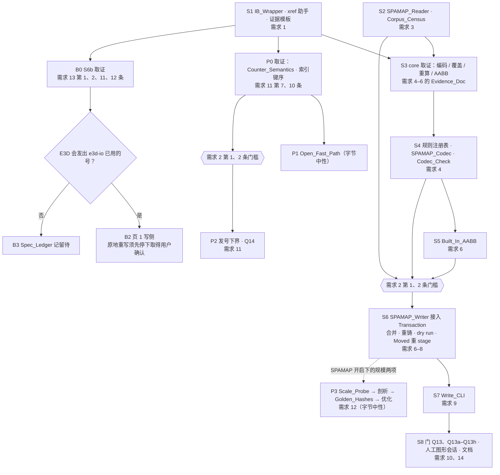
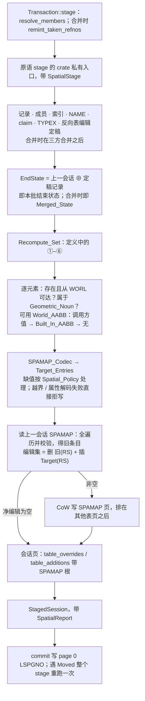

# Design Document

## Overview

第三期要让 e3d-io 写出的几何元素在 E3D 3.1 里能被空间搜索找到。主线（需求 3–10）：`Transaction` 在插入、改几何、换 owner、删除时，按 E3D_Core 的规则维护 SPAMAP 表。其次两项（需求 11、12）：`Transaction::open` 压到 1 s 以内并加上页 1 发号下界；单会话 staging 做到近线性。页 1 桶表写侧（需求 13）视取证结果决定是否纳入。流程沿用 Phase_3_Workflow：先经仓内 IB_Wrapper 读 `core.dll`，落 Evidence_Doc，然后依次做读侧、写侧，最后过真 E3D TTY 门。全设计有两条约束：一是所有依赖 E3D_Core 行为的地方都从规则注册表取规则，规则未坐实时统一走 D7 回退，代码里不留零散的假设；二是每个 D# 依赖点只收在一个常量、枚举或模块里，改选备选时只动那一处。

### 切片与依赖



- 取证门槛 G1、G2（需求 2 第 1、2 条）只卡 SPAMAP 维护、发号下界、页 1 写侧这三个非字节中性的能力。它们的首个写侧提交，其父提交里须已有一份 Evidence_Doc（写明例程地址与 Corpus 核对），还须已有不在 `src/write/` 下的读侧解码，以及以 Corpus 为输入的测试。S2、S4、S5 都不在 `src/write/` 下，可以先于门槛落地；Codec_Check 本身就是证据中 Corpus 核对所用的命令。
- 可并行：P 链、B 链与 S 链互不依赖。P1、P2 先后不限：P1 先落时，对照值是扫描 max + 1；P2 落地后，改为它与 Bucket_Floor 二者取大（需求 11 第 4 条）。P3 只依赖基线，S6 落地后再补测 SPAMAP 开启时的两项（需求 12 第 4、7 条）。
- P1、P3 是字节中性的，按需求 2 第 7 条验收，不受门槛约束；但 P1 仍要等 P0 取得需求 11 第 10 条的键序证据。
- 文档改动（需求 14）随 S6–S8 落地。需求 16 的不做项与触发条件记在 tasks 文档（Spec_Ledger），本设计不展开。

## Architecture

### 落点

| 位置 | 内容 | 理由 |
|---|---|---|
| `tools/ida/`：`ib.ps1`、`xrefs_to.py`、`queries/`、`EVIDENCE_TEMPLATE.md`、`check_evidence.ps1` | IB_Wrapper、IB_Xref_Helper、受版本管理的查询文件、证据模板与机检 | 用 PS 5.1，与 `tools/e3d/*.ps1` 一致；需求 1 第 7 条要求查询文件放在 `tools/ida/` |
| `src/index/spamap.rs` | SPAMAP_Reader | 读侧：不放在 `src/write/`，也不调用它（需求 2 第 2 条） |
| `src/core_rules.rs` | 规则注册表 | 读侧工具与写侧共用，必须早于首个写侧提交存在 |
| `src/spatial/`：`mod.rs`、`state.rs`、`codec.rs`、`aabb.rs`、`candidates.rs` | 值类型、`SpatialState`、SPAMAP_Codec、Built_In_AABB、候选规则 | 都是纯函数。门槛要求的 Corpus 核对就是跑它们，所以必须能先于首个写侧提交落地，不能放在 `src/write/` |
| `src/write/spamap/`：`mod.rs`、`end_state.rs`、`plan.rs`；`src/write/keyed_cow.rs` | SPAMAP_Writer；CoW 按叶值宽泛化 | 写侧 |
| `src/write/alloc.rs` | 发号，从 `transaction.rs` 抽出 | Open_Fast_Path 与发号下界集中在一处 |
| `src/write/bucket.rs` | 页 1 写侧 | 只在需求 13 第 3 条的条件成立时创建 |
| `src/bin/e3d-descriptor.rs` | 新子命令 `spamap`、`spamap-census`、`spamap-check`、`world-frame`、`next-word1` | 沿用现有的只读诊断 CLI |
| `src/bin/e3d-write.rs` | `aabb`、`--spatial`、报告 | Write_CLI |
| `examples/write_scale_probe/` | Scale_Probe | 符合仓内探针惯例（`examples/*_probe.rs`）；`cargo run --release --example` 一条命令即可，不进库 API |
| `tests/common/golden.rs`、`tests/golden/` | Golden_Hashes | 挂在测试夹具上，库里不插桩 |
| `tools/e3d/` | 门 | 沿用现有组织；`format0_gate*` 不改 |

### staging 流水线



- 挂点：SPAMAP 规划在记录内容定稿之后、任何一页写出之前运行，是纯内存计算。所有拒写都发生在追加第一页之前，所以「文件逐字节不变」不依赖 rollback。如果实现时发现原语在挂点之前已经写了页，就把拒写接到现有的 rollback 截断路径（与冲突拒写同一条路），并用测试断言文件逐字节不变。
- 公开原语 `stage_element_session[_with]`、`stage_merge_session_with` 签名不变，内部以 `None` 调用 crate 私有入口，即不维护 SPAMAP，效果同「关闭」，写出 0.4.0 的字节。SPAMAP 只经 Transaction 维护。理由有二：Merged_State 只在合并原语内部成形，挂在原语内部才能按合并后的状态计算；也不必给原语加公开字段、扩大公开面。
- 页序：SPAMAP 页排在所有其他表页之后、会话页之前。「关闭」时 Recompute_Set 为空，既不读表也不分配页；净编辑为空时同样不分配页。这两种情况下，其他结构的页号都与 0.4.0 相同（需求 7 第 6 条、需求 15 第 3 条）。page 0 仍是唯一提交点：stage 之后、commit 之前，读侧读到的仍是上一会话的表（需求 7 第 7 条）。
- Recompute_Set 与 Target_Entries 只按本批结束状态求，同一元素的中间状态不参与（需求 7 第 13 条）。
- SPAMAP_Record_Item：只在需求 5 第 5 条坐实 E3D 会写它时启用。这时 plan 另产出记录项补丁，在记录分页之前并入写集；这可能把本批本来没写的后代记录也带进来。未坐实，或坐实为「不写」时，这一步为空。

合并与 Moved 重 stage：
- 合并时，EndState 的底、旧 SPAMAP 表和表目录都取 Merge_Latest（需求 8 第 1 条）。合并模块已有 base 与 Merge_Latest 的比较结果，经 `EndState::theirs_changed` 交给 plan，用于判定调用方给的值是否失效（需求 8 第 6 条）；祖先链上的元素按需惰性比较。
- 重铸映射（给定号 → 写入号）传给 plan：调用方按原号给出的 World_AABB 改挂到新号，条目按新号编键，原号下不登记条目（需求 8 第 3 条）。
- `SpatialStage` 只保存输入：Spatial_Policy，以及按调用方 refno 记下的 World_AABB；派生量都在每次 stage 内重算。`commit_observed` 遇 `Moved` 会重跑整个 stage，Recompute_Set、重铸、失效与不可达判定随之全部重做（需求 8 第 7 条）。

### D7 回退

规则的坐实状态是编译期常量。Transaction 只能拿到 `RuleSet::confirmed()`，其中未坐实规则的实现槽恒为 `Pending`，所以写侧的任何构建都不会执行未坐实的规则。这比 D7 只约束发布提交更严，发布提交自然满足。候选实现只能经 `RuleSet::candidates()` 取得，供 Codec_Check 和测试比对假设。

| 依赖的规则 | 未坐实时的行为 |
|---|---|
| Codec 各规则、`spamap.coverage`、Built_In_AABB 各规则，以及需建表时的 `spamap.table_header_rest` | 该元素视为没有可用 World_AABB，原因附规则名，交给 Spatial_Policy（默认拒写整批） |
| 重算表「自身」一类的行，含表中尚未列出的属性 | 按「触发」处理 |
| 后代重算（需求 5 第 3、8 条） | 不纳入 Recompute_Set。这是按 ④⑤ 的字面定义：只收坐实会重算的后代，D7 的「按触发」只针对重算表。要改只动 `core_rules::descendants_included` 一处 |
| SPAMAP_Record_Item | 不写 |
| `alloc.counter_semantics` | 发号 = base 索引 max + 1，打开结果标「计数器未用」 |
| `alloc.index_order` | 不启用 Open_Fast_Path，`open` 全扫描：值不变，耗时同 `c61b097` |
| `bucket.*` | 不写页 1 |

检查分两层。编译期：`core_rules.rs` 里有一条 `const` 断言，保证「实现槽不是 `Pending` ⇒ 状态为 Confirmed」。测试：`tests/core_rules_registry.rs` 断言三点：规则名唯一；每条 Confirmed 规则的出处文件存在，且其「结论」节含该规则名；`src/write/` 下的源码里不出现 `candidates`。

## Components and Interfaces

### IB_Wrapper（`tools/ida/ib.ps1`）

用法：`powershell -NoProfile -File tools/ida/ib.ps1 [--target-idb <path>] [--timeout-s <n>] <ida-bridge 命令与参数…>`。这两个选项由包装器自己消费，转发前剥掉，其余参数原样转发；`--target-idb` 缺省为 Core_IDB。

1. 找安装：依次查 `IDA_BRIDGE_HOME`、`C:\Users\dpc\.agents-old\tools\ida-bridge`、`C:\Users\dpc\.agents\tools\ida-bridge`（这份清单是脚本顶部唯一的常量），取第一处同时含 `src\ida_bridge\` 与 `.venv\Scripts\python.exe` 的。一处都不全时，逐条打印查过的位置和所缺的项（环境变量未设置时注明「未设置」），退出码 90。
2. 子进程环境：只在 `ProcessStartInfo.EnvironmentVariables` 中把所选的 `src` 放到 `PYTHONPATH` 最前面。`sys.path` 上的 PathFinder 排在 venv editable 安装追加的 finder 之前，所以会先找到它。转发前先跑 `python -c "import ida_bridge; print(ida_bridge.__file__)"` 自检，确认解析到的是所选 `src`。不改 `.pth`、PATH 等用户配置。CLI 入口（`python -m …`）以所选安装的 `pyproject.toml` 为准，实现时核对。
3. 拒存盘，在发出任何请求之前检查：参数含 `--save`，命令是 `supervisor save`，`--out-idb` 按第 5 步的规则等于 Core_IDB，或 `-c` 文本、`-f` 文件内容含 `idb.save` / `save_database`。命中任一项即打印原因，退出码 91。只改内存 IDB 的 SQL 写不拦。另外，实现时核对 `supervisor stop` 关库时是否存盘；会存盘的话，就给它补上不存盘参数，或者拒绝该调用。（已核：idalib 实例退出时 `close_database(save=False)`，照转；UI 实例经 `idc.qexit(0)` 退出、IDA 关库即写盘，故 `supervisor stop` 指向 `idaui-<n>`、PID 或解析到 UI 实例时一律以 91 拒绝。）
4. 连桥：TCP 连接所配的桥地址（默认 `127.0.0.1:8765`，取地址的方式与 ida-bridge 一致），2 s 内连不上即退出码 92。打印所试的地址，再按顺序打印 `tools/ida/ib.ps1 server start` 与 `tools/ida/ib.ps1 supervisor start-idalib --idb "<Target_IDB>"`。
5. 解析实例：只对 `exec`、`reset`、`supervisor stop` 做，且仅当调用方没给 `idalib-<n>` / `idaui-<n>` 位置参数时。从 `list` 取每个已连接实例的实例号、PID、IDB 路径与占用 session id；这些字段从 `list` 的 JSON 输出还是 `server status` 取，实现时对所选版本核对。比较时两边都转成绝对全路径，不分大小写，`/` 与 `\` 视同。恰好一个且未被占用时，把它的实例号插为位置参数后转发。没有匹配时退出码 93，打印启动命令；Target_IDB 文件不存在时改为指明这一点，不打印启动命令。多于一个，或唯一的那个被别的 session 占用（占用 id 非空且不等于调用方的 `--session-id`）时退出码 94，逐个打印实例号、PID 与占用 id（没有则写「无」）。
6. 超时：`exec` 的时限取 `--timeout-s`，缺省 60 s，0 表示不设限。到时只结束本地客户端进程树（`taskkill /T /F`），不停实例，也不重发。打印实例号、`tools/ida/ib.ps1 supervisor stop <实例号>` 与启动命令，在「时限 + 10 s」内以退出码 95 退出。
7. 其余情况，以被转发命令的退出码退出。

包装器自身失败时退出码取 90–95，stderr 以 `[ib]` 开头，与转发来的退出码区分开。另有两个附带子命令：`ib.ps1 env` 打印 Core_IDB 的 SHA-256（`Get-FileHash`）、IDA 版本（在实例内调 `ida_kernwin.get_kernel_version()`）与 `git rev-parse HEAD`，每轮取证首尾各跑一次，写入证据的「环境」节（需求 1 第 5、9 条）；`ib.ps1 xrefs <地址>` 调用 IB_Xref_Helper。

### IB_Xref_Helper、查询文件与证据模板

- `tools/ida/xrefs_to.py`：IDAPython，在实例内执行。ida-bridge 一次 `exec` 按 `--sql` → `-f`（依次）→ `-c` 的顺序跑、共用一份 globals，`-c` 总在最后，所以不能用 `-c` 先注入目标：文件定义 `xrefs_to(ea)`，包装器以 `-f tools/ida/xrefs_to.py -c "_result_ = xrefs_to(0x…)"` 调它。脚本用 `ida_xref.xrefblk_t` 的 `first_to(ea, XREF_FAR)` / `next_to()` 一并枚举代码引用与数据引用；`XREF_FAR` 的作用是排除顺序流（新版 SDK 中可能改名为 `XREF_NOFLOW`，实现时按所装版本核对）。遇到 `BADADDR` 或取满 100 000 条即停。输出按源地址排序的 JSON，每条含 `from`、`kind`、`type`、`func`（不在函数内时为空串），截断时带 `truncated: true`。
- 模型对照：`tools/ida/queries/xrefs_to.sql` 从 ida-bridge 的 `xrefs` 表取同一 `to_ea`、去掉 flow 类的 `from_ea`，`tools/ida/check_xrefs.ps1 <地址>` 比较两个集合是否相同（需求 1 第 6 条）。取证用的其他 SQL / IDAPython 也一律放在 `tools/ida/queries/`，证据里以仓库相对路径经 `-f` 引用。
- `tools/ida/EVIDENCE_TEMPLATE.md` 分四节：「环境」写 Core_IDB 的 SHA-256（首尾各一次）、IDA 版本、40 位的 HEAD；「结论」逐条规则写注册表中的规则名、坐实与否、例程起始地址、`pseudocode.n` 行号或指令地址，以及 Corpus 核对（库、命令、一致数 / 总数），未坐实的另写所作假设、须用到它的输入类别与反例；「复现命令」；「反例」。
- `tools/ida/check_evidence.ps1 <doc>` 机检需求 1 第 7–9 条：「复现命令」节只以 `tools/ida/ib.ps1`、按仓内相对路径调用的脚本与 `cargo` 为入口；不含临时目录（`%TEMP%`、`$env:TEMP` 及其展开值）、`idalib-\d+` / `idaui-\d+` 与 IDA_Bridge 安装目录；所引的 `tools/ida/` 文件都受版本管理（`git ls-files --error-unmatch`）；地址为十六进制，哈希 64 位，HEAD 40 位。

### SPAMAP_Reader（`src/index/spamap.rs`）

```rust
pub const SPAMAP_NAME_HASH: u32 = 230_902_453;
pub enum SpamapRead { NoTable { sesno: u32 }, Table { sesno: u32, table: SpamapTable } }
pub struct SpamapTable { pub root: PageId, pub pages: Vec<u32>, /* 条目与 refno 索引 */ }
impl SpamapTable {
    pub fn entries(&self) -> &[SpamapEntry];                                      // 键序，不含哨兵
    pub fn for_refno(&self, refno: RefNo) -> impl Iterator<Item = &SpamapEntry>;  // 保持键序
}
pub fn read_spamap(view: &mut DbView) -> Result<SpamapRead, SpamapReadError>;     // 读 view 打开时选定的会话
pub fn read_spamap_tree(root: PageId,
    read_page: impl FnMut(PageId) -> Result<Vec<u8>, String>) -> Result<SpamapTable, SpamapReadError>;
```

- 从会话页的表目录中找名 hash 为 230902453 的表项；没有就返回 `NoTable { sesno }`，与「有表、0 条」可区分（需求 3 第 9 条）。会话在打开 `DbView` 时选定：`DbView::open_at(path, 640)` 取不到会话即报错，不改读其他会话；SPAMAP_Baseline 即这样取。
- 页解码：`src/index/keyed.rs` 的 `decode::<V>` 按「名 hash + 叶值宽 V」认 4 字键的表页，反向表（`V = 0`）与 SPAMAP（`V = 7`）共用，与写侧 `rewrite_table::<V>` 对称。它查页类型、名 hash、键宽 4、层号 0 的页值宽、空闲字数越界、已用字数按步长（叶 4 + V、内结点 4 + 2）整除，内结点槽取键后的 `(pgno, ext)`，四字全为 `0x80000001` 的槽认作哨兵。**不经 `IndexPageView`**：它要求页头字 1 是 refno 索引表的名 hash（13 387 743），对每一页都会报 `UnexpectedNoun`，且各层一律按 `key_dwords + value_dwords` 切槽（`docs/plans/2026-10-03-write-path-phase-3-milestone-a-plan.md` §2.1）。
- 遍历：用显式栈按槽序深度优先，叶条目从左到右产出。在页解码之上补查需求 3 第 2 条余下的项：子页层号不等于父层号 − 1；内结点没有子页；页被重访（查 `visited` 集合）；相邻非哨兵叶条目（含跨页）不按 4 字无符号严格升序。所有错误都带页号与出错项。
- `read_spamap_tree` 只需要一个读页闭包，所以写侧的 plan 和需求 3 第 6 条的往返测试（内存页）都能用它；它不引用 `src/write/`。
- 按 refno 查：refno 在键的第 2、3 字，而 B+ 树按 Key0 打头的键排序，帮不上忙，只能全表查找。首次查询时对内存中的条目建一张 `refno → 条目下标` 表（O(E)），之后每次查询 O(m)，结果天然保持键序。读整表的代价是 O(P) 页加 O(E)。若需求 5 第 5 条坐实 SPAMAP_Record_Item 含 Key0 与 k，还可按完整键下钻，代价 O(树高)；但 3 746 条这个量级用不着，默认不做。

### Corpus_Census 与 Codec_Check（`e3d-descriptor` 子命令）

- `spamap --db <f> [--session <n>] [--refno <w0/w1>]`：读一张表或一个 refno 的条目，JSON 输出会话号、根页号、页数与条目。门的 Q13g 也用它。
- `spamap-census --input <文件或目录>… [--session <文件>=<n>]…`：输出需求 3 第 7、10、11、12 条要求的各项，另加「按元素的 k 组合」计数。输出确定：输入按路径排序，统计一律用 `BTreeMap`，不写时间戳。以 `ReadOnlyEngine` / `DbView` 只读打开。目录中首部不可解析的文件列为「非库文件」；某库出错时列出错误后继续，全部结束后以非零退出码退出。noun 取自元素记录；「(轴序, 桶)」按普查口径在本命令内计算，不依赖 Codec。
- `spamap-check --input … [--rules confirmed|candidates] [--exclude <文件>]`：对每个库分项输出 Key0（只用条目自身的 6 个值字）、条目数与 k、Spatial_Flags、Built_In_AABB（需求 6 第 9 条）四项的一致数 / 总数与各自前 100 个反例，每个反例附其所依的未坐实规则名。E3D_Authored_Element 按「元素最新记录所在页落在哪个会话的页区间、该会话 USER 不为 `e3dio`」判定。`--exclude` 读受版本管理的剔除清单，每条附会话链证据的出处（需求 4 第 17 条）。
- `world-frame --db <f> --refno <r>`：打印 Built_In_AABB 复合器算出的世界原点与 World_AABB，供 Q13h 与 Probe_Element 预判用。
- `next-word1 --db <f> --extent <w0>`：在读侧算出「全索引 max + 1」与 Bucket_Floor，作为 Q14 与需求 11 第 5 条的期望值。

### 规则注册表（`src/core_rules.rs`）

```rust
#[non_exhaustive] #[derive(Clone, Copy, PartialEq, Eq, Hash, PartialOrd, Ord, Debug)]
pub enum RuleId { /* 下表各行 */ }
pub struct Rule { pub id: RuleId, pub name: &'static str, pub governs: &'static str, pub status: RuleStatus }
pub enum RuleStatus {
    Confirmed { evidence: &'static str },                  // Evidence_Doc 路径与节名
    Unconfirmed { assumption: &'static str, inputs: &'static str, evidence: Option<&'static str> },
}
pub const RULES: &[Rule];                                    // 设计阶段每条都是 Unconfirmed；const 才能进 const 断言
pub struct RuleSet { /* 每条规则一个类型化实现槽，未坐实时为 Pending */ }
impl RuleSet {
    pub fn confirmed() -> &'static RuleSet;                  // Transaction 唯一的入口
    #[doc(hidden)] pub fn candidates(pick: &CandidatePick) -> RuleSet; // 只给 Codec_Check / 测试
}
pub enum Trigger { Triggers, DoesNotTrigger, Unconfirmed }
pub fn recompute_row(noun: u32, attr: u32) -> Trigger;       // 表中没有的属性为 Unconfirmed
pub fn member_order_row(noun: u32) -> Trigger;
pub fn descendants_included(kind: DescendantKind, depth: u32) -> bool;  // depth 1 = 成员
```

每条规则一个实现槽 `Slot<T, C> { Pending, Confirmed(T), Candidate(C) }`：`T` 是该规则的实现类型，设计阶段都是空枚举、不预设任何取值，所以确认集的槽只能是 `Pending`；某条规则坐实时，在同一提交里按 Evidence_Doc 给 `T` 加上变体、在 `RuleSet::confirmed()` 里填 `Confirmed`，并把状态改为 `Confirmed`。`C` 是该规则的候选函数类型（`core_rules::candidate`，如 `fn(extent: i64) -> Option<u8>`），实现放在 `src/spatial/candidates.rs`，只经 `candidates(&CandidatePick)` 以 `Candidate` 填进仍为 `Pending` 的槽；尚无候选的规则 `C = NoCandidate`（空枚举）。（里程碑 B 计划 §3.1：空的 `T` 造不出值，候选不能与确认同型。）

| 规则名 | 管什么 | 出处需求 |
|---|---|---|
| `spamap.table_shape` | 页类型、名 hash、键宽 4、叶值宽 7、内结点槽 | 需求 3；需求 7 第 8 条 |
| `spamap.table_header_rest` | 建表时与内结点页的其余页头字 | 需求 7 第 8 条 |
| `spamap.word_sign` | 键字 / 值字是否有符号、键比较是否有符号、Key0 的宽度与越界 | 需求 4 第 12、13 条 |
| `spamap.rounding` | 毫米化为 0.1 mm 时 min / max 的取整 | 需求 4 第 1、2 条 |
| `spamap.key0` | `N × 10^8 + 最短轴 min`，`N = 6 × 轴序 + 桶` | 需求 4 第 3、10 条 |
| `spamap.short_axis` | 最短轴按毫米还是 0.1 mm 判定；并列时取哪根 | 需求 4 第 1、4 条 |
| `spamap.zero_extent` | 最短轴 extent 为 0 | 需求 4 第 5 条 |
| `spamap.bucket` | 桶划分、分界归属、超出语料所见范围时的取值 | 需求 4 第 6 条 |
| `spamap.entries_k` | 条目数、k 的含义、k ≥ 1 条目值字的来源 | 需求 4 第 7、14、15 条 |
| `spamap.flags` | Spatial_Flags 逐位的含义 | 需求 4 第 8、9、11 条 |
| `spamap.coverage` | 每个 noun 是否为 Geometric_Noun（三态） | 需求 5 第 1、7、10 条 |
| `spamap.recompute.<NOUN>` | 重算表「自身」一类各行与成员次序 | 需求 5 第 2 条 |
| `spamap.descendants.{move,pos,ori}` | 换 owner、改 POS、改 ORI 时各层后代是否重算 | 需求 5 第 3、8 条 |
| `spamap.delete_residue` | 删除后后代条目是否残留（写侧按需求 7 第 5 条一律删去） | 需求 5 第 4 条 |
| `spamap.record_item.<NOUN>` | 是否写 SPAMAP_Record_Item，以及它的布局 | 需求 5 第 5、6 条 |
| `aabb.ori_form`、`aabb.compose` | ORI 的存储形；复合顺序与参与复合的 owner noun | 需求 6 第 1 条 |
| `aabb.box`、`aabb.cyli`、`aabb.degenerate` | 由自身属性得包围盒的方法；尺寸为 0 或负时的处理 | 需求 6 第 1 条 |
| `aabb.arithmetic` | 算术精度；不能逐字复现时改用的判据 | 需求 6 第 9、16 条 |
| `alloc.counter_semantics` | Counter_Semantics | 需求 11 第 7、8 条 |
| `alloc.index_order` | 索引键是否按 (word0, word1) 排列，以及比较方式 | 需求 11 第 10 条 |
| `bucket.collision`、`bucket.persist` | E3D 会不会撞号；页 1 的落盘方式 | 需求 13 第 1、2 条 |

### SPAMAP_Codec（`src/spatial/codec.rs`）

```rust
pub struct SpamapCodec<'r> { rules: &'r RuleSet }
pub enum Encoded {
    Entries { entries: Vec<SpamapEntry>, relied_on: Vec<RuleId> }, // candidates 下列出所用的未坐实规则
    NeedsUnconfirmed(Vec<RuleId>),
    MissingInput(&'static str),                                    // 需求 6 第 15 条
}
impl SpamapCodec<'_> {
    pub fn encode(&self, refno: RefNo, state: &dyn SpatialState, aabb: &WorldAabb)
        -> Result<Encoded, CodecError>;                             // CodecError::OutOfRange
    pub fn key0_of(&self, words: &[u32; 6]) -> Result<u32, Vec<RuleId>>; // 需求 4 第 10 条的纯编码核对
}
```

编码次序：取整（`spamap.rounding`）→ 可表示范围（`spamap.word_sign`，越界返回 `OutOfRange { refno, axis, value_mm, range }`）→ 最短轴（含并列时取哪根）→ 零 extent → 桶 → Key0 → 条目数与 k → Spatial_Flags（经 `state` 读元素记录）。任何一步用到的规则处于 `Pending`，就收集其规则名，结果为 `NeedsUnconfirmed`，不产出部分条目。Codec 不看 Spatial_Policy，也不管 D7，怎么处理由调用方决定。

### Built_In_AABB（`src/spatial/aabb.rs`、`state.rs`）

```rust
pub trait SpatialState {                          // 一份元素状态的只读视图
    fn noun(&self, r: RefNo) -> Option<u32>;
    fn owner(&self, r: RefNo) -> Option<RefNo>;
    fn attr(&self, r: RefNo, hash: u32) -> Result<Option<DescriptorValue>, UndecodableAttr>; // 读写两侧共用的解码值
}
pub struct WorldFrame { pub rotation: [[f64; 3]; 3], pub origin_mm: [f64; 3] }
pub trait FrameComposer {                         // 可替换：ORI 存储形与复合顺序待取证
    fn world_frame(&self, s: &dyn SpatialState, r: RefNo) -> Result<FrameOutcome, UndecodableAttr>;
}
pub const BUILT_IN_NOUNS: &[&str] = &["BOX", "CYLI"];  // D1；备选 A 置空，备选 B 在此扩充
pub struct BuiltInAabb<'r> { rules: &'r RuleSet, composer: &'r dyn FrameComposer }
impl BuiltInAabb<'_> {
    pub fn compute(&self, s: &dyn SpatialState, r: RefNo) -> Result<AabbOutcome, UndecodableAttr>;
}
pub enum AabbOutcome { Aabb(WorldAabb), NeedsUnconfirmed(Vec<RuleId>), NotBuiltIn }
```

- `SpatialState` 有两份实现：读侧的 `ReadState`（`src/spatial/state.rs`，按会话读记录，供 Codec_Check、Q13g 与需求 6 第 9 条用）和写侧的 `EndState`。同一套 Codec / AABB 代码先在语料上核对，再用于写侧。
- 默认复合器 `ChainComposer`：沿 owner 链上溯到 WORL，对 `aabb.compose` 列出的 noun 取 POS / ORI 复合；ORI 按 `aabb.ori_form` 解码。两条规则任一为 `Pending` 时，返回 `NeedsUnconfirmed`。
- BOX 用 XLEN / YLEN / ZLEN，CYLI 用 DIAM / HEIG。用解析解、局部外包盒变换还是离散面，由 `aabb.box` / `aabb.cyli` 定；尺寸为 0 或负时走 `aabb.degenerate`。
- 输出为毫米 `f64`，取整只在 Codec 里做。若 `aabb.arithmetic` 坐实 E3D 用单精度，复合器也按单精度计算以复现；不能逐字复现时，按需求 6 第 16 条改用容差判据。
- 调用方给的值优先（需求 6 第 4 条）；Merge_Commit 中这个值是否失效由 plan 判定，失效后回到自算。所需属性解码不了时返回 `UndecodableAttr { refno, name, hash }`，plan 据此拒写整批（需求 6 第 8 条，「跳过」下亦然）。

### SPAMAP_Writer（`src/write/spamap/`、`src/write/keyed_cow.rs`）

```rust
pub(crate) struct SpatialStage { policy: SpatialPolicy, given: BTreeMap<RefNo, WorldAabb> } // 后给覆盖先给
pub(crate) struct SpamapPlan {
    pub edits: SpamapEditSet,
    pub report: SpatialReport,
    pub record_items: Vec<(RefNo, RecordItemPatch)>, // 仅当需求 5 第 5 条坐实「写」时非空
}
impl SpatialStage {
    pub(crate) fn plan(&self, end: &EndState<'_>, remint: &[(RefNo, RefNo)]) -> Result<SpamapPlan, SpatialError>;
}
```

- `EndState`（`end_state.rs`）：上一会话与本批定稿记录叠加而成的视图，实现 `SpatialState`。另外提供：`previous()`，即上一会话的视图；`in_new_index(r)`；`members(r)`，对被删元素返回其上一会话的成员再按本批 move 调整后的集合，用来找 owner 链经过被删元素的那些元素；`reachable_from_worl(r)`；`theirs_changed(r)`，只在合并时有意义。
- Recompute_Set：按定义 ①–⑥ 求。候选只来自本批触及的 refno（插入、写属性、move、删除及其连带的元素）和它们在 EndState 下的后代。「改了」指 EndState 与上一会话的值不同：能解码的比解码后的值，不能解码的比存储字。重算属性取 `recompute_row` 为 `Triggers` 或 `Unconfirmed` 的属性；④⑤ 只收 `descendants_included` 为真的那些层。
- 可用 World_AABB 依次取：`given` 中的值（经重铸映射改挂到写入号；合并中 `theirs_changed` 命中需求 8 第 6 条的任一项即失效），`BUILT_IN_NOUNS` 自算，都没有则为无。
- Codec 编码之后，`NeedsUnconfirmed`、`MissingInput` 与「无值」统一成 `MissingAabb { refno, given_as, reasons }`。「要求」下只要出现一个，就返回 `SpatialError::MissingAabb(列表)`；「跳过」下该元素的 Target_Entries 为空，并记入报告。
- 旧条目：只有 Recompute_Set 非空时才读上一会话的表。用 `read_spamap_tree` 全遍历并校验，不合规即 `MalformedTable`；再用 `for_refno` 取出旧条目。Recompute_Set 为空时不读表，所以坏表不会挡住无关的批次。
- 编辑集：对 Recompute_Set 中的每个 r，删去 `old(r)` 的全部键，插入 `Target(r)`；整个集合规范成「先全部删，再全部插」。每个 r 都满足 `old(r) == Target(r)`（按 11 字集合比较）时，净编辑为空：不分配 SPAMAP 页，表目录项原样沿用。
- CoW：`keyed_cow.rs` 按叶值宽泛化为 `rewrite_table::<V>`，`V = 0` 是现有的键表，`V = 7` 给 SPAMAP。`rewrite_keyed_table` 变成 `V = 0` 的薄包装，行为与字节不变，由它现有的单测和需求 15 第 3 条的逐字节对比守住。复用而不另写，是因为哨兵槽、内结点的 `(pgno, ext)`、共享页只复制一次、容忍 529 / 534、`root: None` 时建表，SPAMAP 与现有键表完全一样，差别只是叶槽多 7 个值字。插入已存在的键保留旧值（529），删除不存在的键不动（534），值的变化用同一集合中的一删一插表达。分裂策略沿用现有算法；若 Scale_Probe 测出超过需求 12 第 7 条的上界，只给 `V = 7` 加满填策略，`V = 0` 不动。
- 建表：上一会话没有 SPAMAP、而 Target_Entries 合计至少一条时，以 `root: None` 新建，页头按 `spamap.table_header_rest`。新表项经 `build_session_page` 的 `table_additions` 追加；表目录满时即现有的 `WriteError::TableDirectoryFull { count, room }`，映射为整批拒写（需求 7 第 12 条）。已有的表经 `table_overrides` 改根。
- 拒写条件都在写页之前检查：「要求」下有元素缺可用 World_AABB（需求 6 第 5 条）；自算所需属性解码不了（需求 6 第 8 条）；Codec 越界、上一会话表页不合规、表目录已满（需求 7 第 12 条）。除第一条外，其余在「跳过」下同样拒写。

### Transaction 与公开 API

```rust
impl<'a> Transaction<'a> {
    pub fn with_spatial(self, policy: SpatialPolicy) -> Self;             // 缺省 Require（D3）
    pub fn set_aabb(&mut self, refno: RefNo, aabb_mm: [f64; 6]) -> Result<(), TransactionError>;
    pub fn allocation_basis(&self) -> &AllocationBasis;                    // 需求 11 第 6、8 条
}
impl StagedSession { pub fn spatial(&self) -> &SpatialReport; }          // dry run 的报告来源
pub struct TransactionCommit { /* 现有字段 */ pub spatial: SpatialReport }
pub enum TransactionError { /* 现有变体 */ Spatial(SpatialError) }
```

- `set_aabb` 在调用处校验，出错时草稿不变：含非有限数或某轴 min > max，返回 `SpatialError::InvalidAabb { refno, axis }`；noun 已按 `spamap.coverage` 坐实为非 Geometric_Noun，返回 `NotGeometric { refno, noun }`。noun 的覆盖状态尚未坐实时，调用处不拒，留给 stage 按 D7 处理。
- 兼容：新类型 `SpatialReport`、`SpatialError`、`AllocationBasis` 都标 `#[non_exhaustive]`，`SpatialReport` 与 `SpatialPolicy` 实现 `Default`。`TransactionCommit` 加字段、`TransactionError` 加变体都是破坏性变化：前者没有 `Default` / builder，按需求 15 第 9 条在 CHANGELOG 写明结构体字面量与解构的迁移方法；后者写明 match 的迁移方法，并借这次给 `TransactionError` 标上 `#[non_exhaustive]`，以后再加变体就不会破坏下游。落地前先在 Downstream_Crates 中搜这两个类型的穷尽 match 与字面量（本步未核对）；搜到即与需求 15 第 4 条冲突，先停下与用户确认。
- D3 默认「要求」：对插入非 Built_In_AABB 几何 noun 的调用方是行为变化，记入 CHANGELOG（需求 14 第 4 条）。`open` / `open_at` 签名不变，发号改由 `alloc.rs` 提供。

### Write_CLI（`src/bin/e3d-write.rs`）

- `aabb`（世界系毫米，`[minx, miny, minz, maxx, maxy, maxz]`）只能出现在 `insert`、`set`、`move` 上。读指令文件时校验形状：恰好 6 个 JSON 数、都是有限数、每轴 min ≤ max；出现在其他指令上即拒。`insert` 拿到新 refno 后调 `set_aabb`；只带 `aabb` 的 `set` 只调 `set_aabb`，不改属性（需求 9 第 6 条）。所有拒绝都在建批阶段：写明 `op #n` 与原因，退出码 1，不写任何字节（需求 9 第 2、7 条）。
- `--spatial require|skip|off`，缺省 `require`；非法值走现有的命令行参数错误路径，列出合法取值，在打开库之前就退出。`--no-dictionary` 不受影响。
- 来源指令：CLI 维护 `touched: BTreeMap<RefNo, Vec<usize>>`，记下每个 refno 被哪些指令写过、move 过、删过或给过 `aabb`。报告中 Recompute_Set 每个元素的来源指令，是它的每个 `RecomputeCause` 所指 refno（自身或祖先）在 `touched` 中的指令序号之并。
- `--report` 增加 `spatial` 节（见 Data Models），refno 用写入号，重铸时保留 `given`。dry run 先从 `StagedSession::spatial()` 取同一份报告，再 rollback。按需求 6 第 5、8 条拒写时退出码 1，逐个列出 refno、原因与来源指令。

### 发号下界与 Open_Fast_Path（`src/write/alloc.rs`）

```rust
pub(crate) struct Allocator {
    index_root: PageId,
    floors: BTreeMap<u32, u32>,          // Bucket_Floor，只含页 1 列出的扩展
    next: HashMap<u32, u32>,             // 惰性：某扩展第一次发号时才求
    basis: AllocationBasis,
}
impl Allocator {
    pub(crate) fn open(view: &mut DbView, index_session: SessionSummary, page1: &[u8]) -> Self;
    pub(crate) fn allocate(&mut self, word0: u32) -> Result<RefNo, TransactionError>;
}
fn max_word1_seek(index: &mut IndexCursor, word0: u32) -> Option<u32>; // Open_Fast_Path
fn max_word1_scan(index: &mut IndexCursor) -> BTreeMap<u32, u32>;      // 朴素对照，即 c61b097 的做法
```

- Open_Fast_Path：`open` 只读 page 0、会话页与页 1，不碰索引叶。某个扩展第一次发号时，才沿最右路径找严格小于 `(word0 + 1, 0)` 的最大键，代价 O(树高) 页；为此在读侧的 `IndexCursor` 上加 `last_before(RefNo)`。前提是索引按 `(word0, word1)` 升序、比较方式与 `alloc.index_order` 坐实的一致。它未坐实时，`open` 退回全扫描，值不变、耗时同 `c61b097`；扫描不推迟到首次发号。
- 下界：`alloc.counter_semantics` 坐实时，首个待发 word1 = max(索引 max + 1, Bucket_Floor)。未坐实时为索引 max + 1，`basis.counter = Unconfirmed`（需求 11 第 8 条）；页 1 解析失败时同样为索引 max + 1，`basis.counter = Unavailable`（需求 11 第 6 条）。页 1 没有列出的扩展（如主扩展）同样走 seek（需求 11 第 9 条）。
- `open_at(base)`：索引取 base 会话的，页 1 取打开时读到的（需求 11 第 12 条）。重铸时，`remint_taken_refnos` 以 Merge_Latest 的索引与提交时读到的页 1 另建一个 `Allocator`（需求 11 第 11 条）。
- 计时只计 `Transaction::open` 调用本身：release 构建、热文件缓存、连续三次取中位数（需求 11 第 1 条）。Scale_Probe 另报首次发号的耗时，说明惰性求值没有把开销挪到后面藏起来。

### Scale_Probe 与 Golden_Hashes

- `examples/write_scale_probe/main.rs`（批次构造在同目录 `batch.rs`，测试以 `#[path]` 引用），一条命令：`cargo run --release --example write_scale_probe -- --source <ams8000_0001> --n 10000,100000 --runs 3 [--spatial require|off] [--open-only <库>]`。每次运行把原件复制到临时目录，运行前后比对原件的 SHA-256，并先整读一遍副本求得热缓存。批次按 T2「单会话 A」的形状构造；分阶段报告 open / build / stage / commit 的墙钟时间与峰值 RSS（用 `K32GetProcessMemoryInfo`，不加依赖）；按页头把追加页分为记录 / 索引 / claim / TYPEX / SPAMAP / 其他 / 会话页七类计数；提交后用读侧逐个核对 owner 的成员与期望相同；输出 JSON 与拟合的幂指数。
- 先剖析后优化：以 `CARGO_PROFILE_RELEASE_DEBUG=true` 构建带符号的 release，用本机可用的采样剖析器（WPR / WPA 或同类工具，所用工具记入 Spec_Ledger）跑 n = 10 000 与 n = 100 000。在 Spec_Ledger 写明超线性的来源之后，才改 staging 代码（需求 12 第 2 条）。设计不预判热点。
- Golden_Hashes 挂在 `tests/common/golden.rs`：`DbCopy` 的 `Drop` 对最终文件求 SHA-256。会话只追加，最终文件包含该副本上每个批次的全部字节，所以一次哈希就覆盖它的全部批次。键为（测试 crate，线程名即 libtest 给的测试名，该线程内的序号）。`#[track_caller]` 记下的 `DbCopy::of` 调用点只进报错信息、不进键：8.10、11.8 要在被守的测试里加行，按行号成键会让编辑点以下的金样静默失配。副本取自 `tools/golden/snapshot.ps1` 钉下的样本快照（`D:\e3dio-fixtures\phase3`，`E3DIO_WRITE_FIXTURES` 可改；快照里没有的样本照旧取装机原件），金样每条另存源样本的 SHA-256：源哈希不符报「样本漂移」，与写出字节不符分开报（`docs/plans/2026-10-03-write-path-phase-3-milestone-a-plan.md` §2.2）。
  - 录制：`tools/golden/record.ps1` 在优化首个写侧提交的父提交上连跑两遍写测试，剔除两遍不同的键（如用 `SessionClock::now` 的 `write_stage6_spread`；剔除项与原因记入 Spec_Ledger），写出 `tests/golden/write_hashes.json` 入库。Scale_Probe 批次固定时钟、refno 按源文件预铸，由 `tests/write_scale_golden.rs` 复用 `batch.rs` 比对；Transaction 若没有显式指定 refno 的插入入口，就改走原语路径。
  - 比对与退役：此后 `Drop` 遇到金样中有的键即比对，不符则测试失败（线程已在 panic 时跳过），所以普通的 `cargo test --no-fail-fast` 就是需求 2 第 7 条要的逐字节对比。此后第一个非字节中性能力落地的提交重录或删去金样，并记入 Spec_Ledger。

### S6b 条件分支

- 取证：经 IB_Wrapper 读 `DB_DB::updateBucketList`、`DB_DB::getRefBuckets`、`db_get_bucket`、`db_add_bucket`，坐实 `bucket.persist`；再由 `tools/e3d/s6b_probe.ps1` 驱动一次 E3D_Session，坐实 `bucket.collision`：比对 `NEW` 前后的页 1 字节与会话链（需求 13 第 11 条），并分测「已发且仍存在」与「已发后删去」的 word1（需求 13 第 12 条）。
- 不撞号：在 Spec_Ledger 把 S6b 写侧记为留待，附证据与触发条件（需求 13 第 5 条），不建 `bucket.rs`。
- 撞号，且页 1 写时复制、由 page 0 指向：`src/write/bucket.rs` 以上一会话（合并时为 Merge_Latest）的页 1 为起点，把每个扩展的计数器抬高，使其 Bucket_Floor 大于新索引与本批发出的每个 word1（重铸后的号计入，原号不计）；保留全部条目，计数器不降。新页 1 作为追加页写出，由最后写入的 page 0 指向，提交点不变。
- 撞号，且 E3D 原地重写页 1：先停下。把「page 0 不再是唯一提交点」对崩溃一致性的影响写进 Spec_Ledger，取得用户确认后才实现（需求 13 第 4 条）。
- 对应的门问放在 `alternate_write_gate.ps1`，暂记 Q15，要求在 `c61b097` 上 FAIL（需求 13 第 8 条）。

### 门（`tools/e3d/`）

- `write_gate.ps1` 在 Q12e 之后加 Q13 组与 Q14。e3d-io 的写入全部经 `e3d-write apply --report` 与新的 Gate_Ops 完成：`q13_control.json`（`--spatial off`，写 Control_Box），`q13_boxes.json`（`require`，写 ZONE 及其下的 BOX、Q13_Box 与用作 Probe_Element 的 BOX），`q13_move.json`、`q13_xlen.json`、`q13_delete.json`，`q13_cyli_equi.json`（CYLI、带平移与旋转的 EQUI 及其下的 BOX），`q14_named.json`（在扩展 24384 写一个带名字的元素）。会话 USER 为 `e3dio`，所问的 refno 从 `--report` 读取。
- E3D 侧：`write_gate.mac.template` 加 Q13 段，每问以 `$P [Q13x-BEGIN]` / `$P [Q13x-END]` 夹住。只用 PML1：`VAR !r EVALUATE (REF) FOR ALL BOX WITHIN VOLUME =w0/w1 <余量>` 与 `Q VAR !r`，Q13h 另加 `Q POS WRT /*`。Q13 排在 Q13a 之前，先以包含 Control_Box 的 Probe_Element 为体积搜一次，再以 Control_Box 本身为体积搜一次（需求 10 第 13 条）。Q13g 所需的「E3D 改 XLEN 并 SAVEWORK」放在 `write_gate_e3d_saves.mac.template`。不用 PML2 对象与 `COLLECT`，不对图元设 `DESC`。
- 判定：`write_gate.ps1` 按标记切出每问的日志段，按需求 10 第 12 条判「列出 / 省略 / 无 `(2,536)`」，每问输出一行 `PASS <问号>` 或 `FAIL <问号>`；Q13 为 FAIL 时，Q13a–Q13h 一律 FAIL。三问要借助读侧：Q13g 用 `e3d-descriptor spamap` 与 `spamap-check --refno` 比对 E3D 写的条目与 Codec 的结果；Q13h 用 `world-frame` 比世界原点，各轴之差 ≤ 0.1 mm；Q14 用 `next-word1` 算出期望的 word1，与 E3D `Q REF` 比对。
- Probe_Element 预判：脚本由 `world-frame` 的 World_AABB 与余量算出相交关系，打印 `PROBE <问号> …` 行，人工抄入 Spec_Ledger（需求 10 第 15 条）。结束时打印 `TIME total_s=… q13_s=…`（需求 10 第 17 条）。
- 人工图形会话只做一次，记入 `docs/evidence/YYYY-MM-DD-e3d-spatial-gui-session.md`，截图放 `docs/evidence/assets/`，不算门问。`alternate_write_gate.ps1`（5 轮）与 `format0_gate.ps1` 只跑、不改，后者是别人未跟踪的 WIP。

## Data Models

```rust
// src/index/spamap.rs：盘上原值
pub struct SpamapEntry { pub key: [u32; 4], pub value: [u32; 7] }
// 访问器：key0() = key[0]，refno() = (key[1], key[2])，k() = key[3]，
//         aabb_words() = value[0..6]，flags() = value[6]

// 规则 id 与坐实状态：RuleId / Rule / RuleStatus，见「规则注册表」

// src/spatial/mod.rs
pub struct WorldAabb { min_mm: [f64; 3], max_mm: [f64; 3] }       // 构造即校验：有限，min ≤ max
#[derive(Default, Clone, Copy, PartialEq, Eq, Debug)]
pub enum SpatialPolicy { #[default] Require, Skip, Off }           // D3

// src/write/spamap：crate 私有；先全部删、再全部插
pub(crate) struct SpamapEditSet { deletes: BTreeSet<[u32; 4]>, inserts: BTreeMap<[u32; 4], [u32; 7]> }

// 报告与错误（公开）
#[non_exhaustive] #[derive(Default, Clone, PartialEq, Eq, Debug)]
pub struct SpatialReport {
    pub policy: SpatialPolicy,
    pub table: SpamapTableChange,                  // Unchanged | Rewritten { root } | Created { root }
    pub pages: Vec<u32>,
    pub elements: BTreeMap<RefNo, ElementSpatial>, // Recompute_Set 的元素，按写入号
    pub skipped: Vec<MissingAabb>,                 // 「跳过」下没有条目的元素
    pub unused_aabb: Vec<RefNo>,                   // 需求 6 第 13 条
    pub unreachable: Vec<(RefNo, RefNo)>,          // (元素, 被 Merge_Latest 删去的祖先)，需求 8 第 9 条
}
pub struct ElementSpatial {
    pub given_as: Option<RefNo>,                   // 重铸前的号
    pub causes: Vec<RecomputeCause>,
    pub aabb: AabbSource,                          // Given | BuiltIn | None
    pub registered: Vec<SpamapEntry>,              // Target − 旧，按 11 字比较
    pub removed: Vec<SpamapEntry>,                 // 旧 − Target
}
pub enum RecomputeCause { Inserted, OwnAttrs(Vec<u32>), MemberOrder, OwnerChanged,
    AncestorOwner(RefNo), AncestorPose(RefNo), Deleted, AncestorDeleted(RefNo) }
pub struct MissingAabb { pub refno: RefNo, pub given_as: Option<RefNo>, pub reasons: Vec<MissingReason> }
pub enum MissingReason {
    NoValue,                                       // 调用方未给值，且 noun 不属于 Built_In_AABB
    Invalidated,                                   // 需求 8 第 6 条
    Unconfirmed(Vec<&'static str>),                // 规则名，需求 6 第 14 条
    MissingInput(&'static str),                    // 需求 6 第 15 条
}
#[non_exhaustive]
pub enum SpatialError {
    InvalidAabb { refno: RefNo, axis: Axis }, NotGeometric { refno: RefNo, noun: u32 },
    MissingAabb(Vec<MissingAabb>), UndecodableAttr { refno: RefNo, name: String, hash: u32 },
    OutOfRange { refno: RefNo, axis: Axis, value_mm: f64, range: (i64, i64) },
    MalformedTable(SpamapReadError), DirectoryFull { count: u32, room: u32 },
}
#[non_exhaustive]
pub struct AllocationBasis { pub fast_path: bool, pub counter: CounterUse }
pub enum CounterUse { Used, Unconfirmed, Unavailable(String) }
```

SPAMAP 盘上页形（页字数 W 取自库文件头，`ams8000_0001` 为 512）：

| 字 | 叶（层 0） | 内结点（层 ≥ 1） |
|---|---|---|
| 0 | 页类型 5 | 5 |
| 1 | 名 hash 230902453 | 同左 |
| 2 | 0 | 层号 |
| 3 | 键宽 4 | 4 |
| 4 | 值宽 7 | 按 `spamap.table_header_rest` |
| 5 | 按 `spamap.table_header_rest` | 同左 |
| 6 | 空闲字数 | 空闲字数 |
| 7 起 | 11 字槽：键 `[Key0, w0, w1, k]` + 值 `[minx, miny, minz, maxx, maxy, maxz, flags]` | 6 字槽：4 个键字 + `(pgno, ext)` |

- 每页容量：叶 `L = ⌊(W − 7) / 11⌋`（W = 512 时为 45），内结点 `⌊(W − 7) / 6⌋`（W = 512 时为 84）。4 个键字都是 `0x80000001` 的槽是哨兵：读侧不产出、不计数，CoW 保留其原位。
- 读侧按 4 字无符号字典序排键（需求 3 第 1 条）。E3D 是否按有符号比较，由 `spamap.word_sign` 坐实；4 个键字都小于 2^31 时，两种比较结果相同。示例（需求 4 第 20 条）：键 `[300008495, 24384, 26484, 0]`，值 `[8495, 18000, 27500, 11505, 22000, 32500, 2]`。

Write_CLI 的 JSON 增量：`insert`、`set`、`move` 指令可以带 `"aabb": [849.5, 1800, 2750, 1150.5, 2200, 3250]`。`--report` 新增 `spatial` 节，格式如下：refno 的写法与现有的 `reminted` 字段一致；条目按 4 键字 + 7 值字写成十进制有符号整数；`sources` 是来源指令序号；`reasons` 写作「类别:规则名」。

```json
{ "spatial": {
    "policy": "require",
    "table": { "change": "rewritten", "root": 0 },
    "pages": [],
    "elements": [ { "refno": "24384/26484", "given": null, "sources": [0], "aabb": "built_in",
        "registered": [[300008495, 24384, 26484, 0, 8495, 18000, 27500, 11505, 22000, 32500, 2]],
        "removed": [] } ],
    "skipped": [ { "refno": "24384/26490", "reasons": ["unconfirmed:spamap.flags"], "sources": [3] } ],
    "unused_aabb": [ { "refno": "24384/26491", "sources": [5] } ],
    "unreachable": [ { "refno": "24384/26492", "deleted_ancestor": "24384/26480" } ] } }
```

## Correctness Properties

*性质是系统在所有合法执行中都应成立的特征或行为，也就是对系统应做什么的形式化陈述。性质是人读的规格与机器可验证的正确性保证之间的桥梁。*

测试手段：加 `proptest` 作 dev-dependency（精确钉版本，版本号在实现任务里定；失败种子写入 `proptest-regressions/` 并入库）。纯内存性质用默认用例数；要拷贝库文件的性质用 `ProptestConfig::with_cases` 压到 16–32 例，夹具用 `tests/common/write_fixture.rs` 的 `DbCopy::of`；对 Corpus 逐条核对的性质做全量遍历，样本缺失时经 `common::missing` 报 skip，skip 不计为通过。规则的坐实状态按 D7 处理：被测的 Transaction 只用 `RuleSet::confirmed()`；规则坐实前，测试另以 `RuleSet::candidates()` 跑同一组生成器——先确认生成的元素在候选规则下能编出完整条目，再断言 Transaction 视其为无可用 World_AABB、所附规则名与读侧报出的相同；坐实后期望条目改由 `confirmed()` 算。Corpus 核对（Property 5、7、8）在坐实前用 candidates 跑，结果只作取证数据、不作通过判据。

### Property 1: 按 refno 查询等于全表过滤

*For any* SPAMAP 表 T 与 refno r（含 T 中出现的与未出现的），`SpamapTable::for_refno(r)` 返回的序列等于 `entries()` 中键第 2、3 字等于 r 的条目按原序组成的序列。

**Validates: Requirements 3.4, 3.5**

测试手段：proptest 生成随机条目集合，经 `tests/common/spamap_pages.rs`（测试专用建树器，不经 `src/write/`）按随机页长建树，用 `read_spamap_tree` 读回后对照，放在 `tests/spamap_reader_props.rs`；Corpus 遍历放在 `tests/spamap_reader_real.rs`，取各库最新会话，查每个出现过的 refno，另加至少 1 个未出现的 refno。

### Property 2: 条目序列往返

*For any* 按 4 字无符号严格升序、不含哨兵键的条目序列 E 与合法页长 W（含能逼出多层树的小 W），SPAMAP_Writer 把 E 编成页树后，`read_spamap_tree` 无错误读回，读回的序列与 E 逐条 11 字相同、顺序相同。

**Validates: Requirements 3.1, 3.6**

测试手段：proptest，加 Corpus 遍历（读出各库的表后重编、再读回），放在 `tests/write_stage8_spamap_pages.rs`；写侧经一个 `#[doc(hidden)]`、不带规则的建树入口调用。

### Property 3: 畸形页必报错

*For any* 合法页树与需求 3 第 2 条所列任一类单项篡改（页读不出、页类型、名 hash、键宽、叶值宽、空闲字数越界、已用字数非步长整数倍、子页层号不符、内结点无子页、页重访、相邻键不严格升序），`read_spamap_tree` 返回带页号与出错项的 `SpamapReadError`，不返回任何条目列表。

**Validates: Requirements 3.2**

测试手段：proptest 在 Property 1 的建树结果上注入单项篡改，放在 `tests/spamap_reader_props.rs`。

### Property 4: 普查只读且确定

*For any* 输入组合（库文件、目录、`--session`，含非库文件与出错库），`e3d-descriptor spamap-census` 运行前后各输入文件的 SHA-256 不变，同参数两次运行的输出逐字节相同。

**Validates: Requirements 3.8**

测试手段：真跑 bin 的集成测试，固定几种输入组合，放在 `tests/spamap_census_real.rs`。

### Property 5: Codec 三项核对分开计数

*For any* Corpus 库（含 SPAMAP_Baseline），Codec_Check 分别报告 Key0（只用条目自身 6 个值字）、条目数与 k、Spatial_Flags 三项的一致数 / 总数；规则坐实后每项一致数等于总数（反例只按需求 4 第 17 条的剔除清单剔除）；向单条条目注入一项失配，只改变对应那一项的计数。

**Validates: Requirements 4.2, 4.3, 4.7, 4.9, 4.10, 4.11, 4.15, 4.16**

测试手段：Corpus 遍历放在 `tests/spamap_codec_real.rs`；proptest 注入单项失配；计数逻辑是 `src/spatial/` 里的纯函数，`spamap-check` 子命令与测试共用。

### Property 6: Codec 结果三分

*For any* refno、元素状态与 World_AABB（含各轴边界附近与超出 `spamap.word_sign` 可表示范围的坐标、最短轴并列、最短轴 extent 为 0），`SpamapCodec::encode` 恰返回三者之一：`OutOfRange`（指明 refno、轴、毫米值与可表示范围）、`NeedsUnconfirmed`（所列规则名等于编码途中遇到的全部 `Pending` 规则）、完整条目集合；从不返回部分条目。

**Validates: Requirements 4.12, 4.19**

测试手段：proptest，由随机 `CandidatePick` 决定哪些规则有实现，放在 `tests/spamap_codec_props.rs`。

### Property 7: 覆盖对账

*For any* Corpus 中的 E3D_Authored_Element，该元素在所在库最新会话的 SPAMAP 表中有至少 1 条条目，当且仅当该元素满足 `spamap.coverage` 坐实的判定条件。

**Validates: Requirements 5.7**

测试手段：Corpus 遍历，放在 `tests/spamap_codec_real.rs`；E3D_Authored_Element 按会话 USER ≠ `e3dio` 判定。

### Property 8: Built_In_AABB 与盘上逐字相同

*For any* SPAMAP_Baseline 与 Corpus 各库最新会话中有条目的 Built_In_AABB 元素（后者限 E3D_Authored_Element），`BuiltInAabb::compute`（经 `ReadState`）算出的 World_AABB 经 SPAMAP_Codec 编成的条目与盘上该元素的条目逐字相同（条数、4 键字、7 值字）；判据只按需求 6 第 16 条记入 Spec_Ledger 的容差放宽，反例只按需求 4 第 17 条剔除。

**Validates: Requirements 6.9, 6.16**

测试手段：Corpus 遍历，放在 `tests/spamap_aabb_real.rs`，样本含 BOX `24384/24777`。

### Property 9: Recompute_Set 模型

*For any* Spatial_Policy 为「要求」或「跳过」、由 Transaction 公开编辑操作任意组合且提交成功的批次（直接提交与 Merge_Commit；后者的上一会话为 Merge_Latest、本批结束状态为 Merged_State），SPAMAP_Reader 读回的新会话条目序列等于上一会话表中键 refno 不属于 Recompute_Set 的条目与 Recompute_Set 各元素的 Target_Entries 之并（按键序）；「跳过」下无可用 World_AABB 的元素条目为空；给在 Recompute_Set 之外元素上的 World_AABB 只列入 `unused_aabb`，不改该元素的条目。

**Validates: Requirements 6.2, 6.3, 6.4, 6.13, 7.1, 7.2, 7.3, 7.4, 7.5, 7.9, 7.11, 8.2, 8.8**

测试手段：分两层。① `src/write/spamap/plan.rs` 模块内 proptest：合成的 `SpatialState` 加替身编码器，对照按 Recompute_Set 定义 ①–⑥ 直译的参考实现。② 库副本 proptest（16 例），放在 `tests/write_stage8_spamap_model.rs`，只用读侧读回（需求 2 第 5 条）。

### Property 10: 编辑集合幂等

*For any* SPAMAP 表 T（含空表）与编辑集合 E（每个键至多出现一次；先全部删、再全部插），`rewrite_table::<7>` 把 E 应用两次与应用一次得到逐条相同的表，两次都不报错，且结果等于在 `BTreeMap` 上按 534（删不存在的键不改表）/ 529（插已存在的键不改其值）直译的朴素模型。

**Validates: Requirements 7.10**

测试手段：proptest，用内存页，放在 `tests/write_stage8_spamap_pages.rs`。

### Property 11: 多次写入等价于直达结束状态

*For any* 批次 B′（每个元素只写一次、直达结束状态）与在 B′ 中插入中间状态所得的批次 B（多次 update / set、多次 move_to、update 或 move_to 之后 delete），两份相同的库副本分别提交 B 与 B′ 后，新会话 SPAMAP 表逐条相同。

**Validates: Requirements 7.13**

测试手段：库副本 proptest（16 例），放在 `tests/write_stage8_spamap_model.rs`。

### Property 12: 净编辑为空不动表

*For any* Spatial_Policy 为「关闭」的批次，以及 Recompute_Set 中每个元素的 Target_Entries 都与其旧条目逐字相同的批次（含 Merge_Commit），新会话表目录中的 SPAMAP 项与上一会话相同（有无、根页号与 ext），本会话追加的页中没有页类型 5、名 hash 230902453 的页；「关闭」下不因缺 World_AABB 拒写。

**Validates: Requirements 6.7, 7.6, 8.1**

测试手段：库副本 proptest，放在 `tests/write_stage8_spamap_model.rs`。

### Property 13: 写时复制与唯一提交点

*For any* SPAMAP 净编辑非空的批次，提交后上一会话 SPAMAP 表的每一页逐字节不变，新表中不属于旧表的每一页页号都大于上一会话的最后一页；stage 之后、commit / rollback 之前，SPAMAP_Reader 读文件最新会话仍得上一会话的表。

**Validates: Requirements 7.7**

测试手段：库副本 proptest，在 `commit_observed` 的 observe 回调里读，放在 `tests/write_stage8_spamap_model.rs`。

### Property 14: 合并下的保留、重铸与不可达

*For any* Merge_Commit（另一写者在 base 之后提交新增、改动、改挂、删除元素及为元素写条目；含 `Moved` 重 stage），新会话表与 Merge_Latest 表各去掉键 refno 属于 Recompute_Set 的条目后逐条相同；被重铸的插入元素只以新号登记，原号下占用者的条目保留；因 Merge_Latest 删了祖先而不可达的元素没有条目，且列入 `SpatialReport.unreachable`（附被删祖先）。

**Validates: Requirements 8.3, 8.4, 8.7, 8.9**

测试手段：库副本 proptest（16 例），两个写者，其一经 `commit_observed` 在 stage 与 page 0 之间提交以触发 `Moved`，放在 `tests/write_stage8_spamap_merge.rs`。

### Property 15: dry run 与提交一致

*For any* 批次，同一文件状态上 dry run（`stage` + `rollback`）所得的 `SpatialReport` 与提交所得相同（待登记 / 删去的条目逐条相同，或拒写的错误种类与 refno 列表相同），且 dry run 后文件 SHA-256 与长度不变。

**Validates: Requirements 8.5, 9.5**

测试手段：同一副本先 dry run 并断言字节不变，再提交并比对报告，放在 `tests/write_stage8_spamap_model.rs` 与 `tests/write_stage8_spamap_cli.rs`。

### Property 16: 「关闭」下与 0.4.0 逐字节相同

*For any* `tests/write_stage6_*.rs` 中的批次，以 `with_spatial(Off)`、固定 `SessionRequest.clock` 写出的文件与 `c61b097` 上同一批次写出的文件逐字节相同。

**Validates: Requirements 15.3**

测试手段：在任何第三期 `src/write/` 改动之前，用 `tests/common/golden.rs` 录下 `tests/golden/off_compat.json`（`c61b097` 的写出可视同 0.4.0：其 CHANGELOG `Unreleased` 只删了 `e3d-write-box`）；发号下界落地后，只比不含新发 refno 的副本，或以预铸 refno 走原语路径；测试放在 `tests/write_stage8_off_compat.rs`。

### Property 17: 缺值与空间拒写

*For any* 批次与 Spatial_Policy，在批次中注入至多一类原因（A 类：无调用方给值且非 Built_In_AABB、给值在合并中失效、须用未坐实规则、缺 k ≥ 1 条目的输入；B 类：自算所需属性无法解码、Codec 越界、上一会话表页不合规、建表时表目录已满）时，「要求」下 A 类使整批被拒，错误逐个列出 refno（插入元素按调用方所给号，重铸的另附新号）与「类别:规则名」；「跳过」下 A 类不拒写，`SpatialReport.skipped` 恰为这些元素且其条目为空；B 类在「要求」与「跳过」下都拒写；每次拒写后文件 SHA-256 与长度不变。

**Validates: Requirements 2.6, 6.5, 6.6, 6.8, 6.14, 6.15, 7.12, 8.6**

测试手段：库副本 proptest，放在 `tests/write_stage8_spamap_refuse.rs`；表目录已满另作示例测试。

### Property 18: `set_aabb` 校验与取最后一次

*For any* 6 个 f64（含 NaN、±∞、某轴 min > max、min = max）与 noun，`Transaction::set_aabb` 对非有限值或 min > max 返回 `SpatialError::InvalidAabb`（指明 refno 与轴），对已坐实为非 Geometric_Noun 的 noun 返回 `NotGeometric`，出错时草稿与此前接受的值都不变；同一批对同一元素多次成功给值时，stage 只用最后一次。

**Validates: Requirements 6.10, 6.11, 6.12**

测试手段：proptest，放在 `tests/write_stage8_spamap_api.rs`。

### Property 19: CLI `aabb` 与 `--spatial` 校验

*For any* 指令文件（`aabb` 非数组、个数不为 6、含非有限数、min > max、给在 `rename / delete / reorder / reference / unreference` 上、给在非 Geometric_Noun 上）与 `--spatial` 取值，Write_CLI 在写任何字节之前拒绝：指令问题退出码 1、消息以 `op #n` 指明序号与原因；`--spatial` 非法走 `Failure::Usage`（退出码 2）并列出合法取值；`--db` 文件 SHA-256 不变；同一元素多条指令带 `aabb` 时取序号最大的一条。

**Validates: Requirements 9.2, 9.7, 9.8, 9.12**

测试手段：`src/bin/e3d-write.rs` 内 `#[cfg(test)]` proptest 覆盖解析与校验；少量真跑 bin 的测试（`tests/write_stage8_spamap_cli.rs`）核对退出码与文件哈希。

### Property 20: CLI 报告等于读回的差集

*For any* 提交成功（含 dry run）的指令文件，`--report` 的 `spatial` 节中每个 refno 的「登记」恰为读侧读新会话表有、上一会话表无的条目，「删去」反之（11 字整体比较）；refno 为写入号（重铸时保留 `given`），与条目键第 2、3 字一致；`sources` 恰为使该元素进入 Recompute_Set 的指令序号（含改其祖先 owner / POS / ORI、删其祖先的指令）。

**Validates: Requirements 9.4, 9.9, 9.10**

测试手段：真跑 bin 加读侧核对，放在 `tests/write_stage8_spamap_cli.rs`。

### Property 21: Open_Fast_Path 对照全扫描

*For any* Corpus 库及其任一保留会话作 base，Open_Fast_Path 为 base 索引中出现的每个扩展（含 Bucket_Table 未列出的主扩展）算出的首个待发 word1 等于二者之大者：`max_word1_scan` 所得最大 word1 + 1，与该扩展的 Bucket_Floor（Counter_Semantics 坐实且页 1 列出该扩展时）；Counter_Semantics 未坐实时等于扫描最大值 + 1；`IndexCursor::last_before` 与全扫描求得的最大键相同。

**Validates: Requirements 11.4, 11.8, 11.9**

测试手段：每库最新会话全量，加 proptest 抽样保留会话号，放在 `tests/write_stage9_alloc_real.rs`；期望值与 `e3d-descriptor next-word1` 一致。

### Property 22: 发号下界

*For any* 库副本、`open` 或 `open_at(base)` 与插入批次（含 Merge_Commit 中的重铸），每个发出的 word1 大于所用索引（base 会话；重铸时为 Merge_Latest）中该扩展的每一个 word1，且在 Counter_Semantics 已坐实、Bucket_Table 列出该扩展时不低于其 Bucket_Floor（插入发号取打开时读到的页 1，重铸取提交时读到的页 1）。

**Validates: Requirements 11.2, 11.3, 11.11, 11.12**

测试手段：库副本 proptest（16 例），读侧核对新会话索引，放在 `tests/write_stage9_alloc.rs`。

### Property 23: 字节中性能力逐字节相同

*For any* Golden_Hashes 覆盖的写入批次（既有写路径测试批次与 Scale_Probe 批次，固定时钟与预铸 refno），Open_Fast_Path 与 staging 优化各自落地后写出的文件 SHA-256 等于在各自首个写侧提交的父提交上录下的金样。

**Validates: Requirements 2.7, 12.8**

测试手段：`tests/common/golden.rs` 在 `DbCopy` 的 `Drop` 中比对；`tests/write_scale_golden.rs`；金样 `tests/golden/write_hashes.json` 由 `tools/golden/record.ps1` 录制，两遍不同的键剔除并记入 Spec_Ledger。

### Property 24: IB_Xref_Helper 与 SQL 一致

*For any* Core_IDB 中被引用不超过 100 000 次的地址，IB_Xref_Helper 返回的引用源地址集合等于 ida-bridge `xrefs` 表中同一 `to_ea`、去掉 flow 类后的 `from_ea` 集合；超过时结果标 `truncated: true` 且恰含 100 000 条。

**Validates: Requirements 1.6**

测试手段：`tools/ida/check_xrefs.ps1 <地址>`；每轮取证对本轮用到的地址（至少 5 个，含一个被大量引用的）各跑一次，结果记入 Evidence_Doc。

### Property 25: 一轮取证不改 Core_IDB

*For any* 只经 IB_Wrapper 的一轮取证，首条调用前与末条调用后 `ib.ps1 env` 记下的 Core_IDB SHA-256 相同；对任意带 `--save`、`supervisor save`、`--out-idb` 指向 Core_IDB、或载荷含 `idb.save` / `save_database` 的调用，IB_Wrapper 以退出码 91 拒绝，且不向桥发出任何请求。

**Validates: Requirements 1.5**

测试手段：`tools/ida/check_evidence.ps1` 比对 Evidence_Doc「环境」节的两次哈希；拒存盘路径在 `tools/ida/selftest.ps1` 中离线测（假安装目录、不可达的桥地址）。

### Property 26: SPAMAP_Record_Item 逐字相同（仅当需求 5 第 5 条坐实 E3D_Core 写该项）

*For any* Corpus 中带 SPAMAP_Record_Item 的 E3D_Authored_Element，SPAMAP_Writer 由该元素状态写出的项与盘上逐字相同；对任意登记或重算了条目的批次，新会话中这些元素的记录项与同会话表中其条目按 Evidence_Doc 所载对应关系一致。

**Validates: Requirements 5.6**

测试手段：Corpus 遍历加库副本 proptest，放在 `tests/write_stage8_spamap_record_item.rs`。

### Property 27: 页 1 桶表写侧（仅当需求 13 第 3 条成立）

*For any* 写 Bucket_Table 的提交（含 Merge_Commit），写出的页 1 可被 `BucketTable::parse` 解析，第 2 字 = 2 + 3n，每条第 3 字为 0；上一会话（合并时为 Merge_Latest）的每个扩展条目都保留，每个 Bucket_Counter 不低于上一会话的值；每个扩展的 Bucket_Floor 大于新会话索引中该扩展的每个 word1 与本批为该扩展发出的每个 word1（重铸后的号计入、原号不计）。

**Validates: Requirements 13.3, 13.6, 13.9, 13.10**

测试手段：库副本 proptest，放在 `tests/write_stage10_bucket.rs`。

### 不作为性质的条款

以下条款不写成性质测试，按表中方式验证。

| 验证方式 | 条款 |
|---|---|
| `tools/ida/selftest.ps1`（离线） | 1.2；1.4 的桥不可达一支；1.5 的拒存盘路径（另见 Property 25） |
| 取证轮实跑 IB_Wrapper | 1.1、1.3、1.4 其余情形、1.10–1.12 |
| `tools/ida/check_evidence.ps1` 机检 | 1.7–1.9 |
| 提交与门的核查（记入 Spec_Ledger） | 2.1–2.3；2.5（由 Property 9、14、22、27 的读回测试满足） |
| Evidence_Doc 审阅 | 2.4、4.1、4.8、4.13、4.14、4.17、4.18、5.1–5.5、5.8–5.11、6.1、11.7、11.10、13.1、13.2、13.11、13.12 |
| 规则由 Evidence_Doc 坐实、边界进 Property 5 与 6 的生成器 | 4.4–4.6 |
| 示例测试 | 读侧 3.3、3.7、3.9–3.12、4.20；写侧 6.17、7.8（以无 SPAMAP 表的库副本为底）；CLI 9.1、9.3、9.6、9.11、9.13；发号 11.5、11.6 |
| TTY_Gate 门问 | 10.1–10.10、10.12–10.14、10.16；11.13（Q14） |
| 其他门问（仅当 13.3 成立） | 13.7（`alternate_write_gate.ps1`）、13.8（暂记 Q15） |
| 人工图形会话 | 10.11 |
| 门输出抄入 Spec_Ledger | 10.15、10.17 |
| Scale_Probe 测量 | 11.1、12.3、12.4、12.6、12.7 |
| Scale_Probe 运行与自检 | 12.1、12.5、12.9、12.10 |
| Spec_Ledger 记录 | 12.2、12.11、13.4（须用户确认）、13.5、15.5–15.7、16.1–16.9 |
| 文档审阅 | 14.1–14.9（14.1、14.3 可 grep 机检）、15.9 |
| Build_Checks | 15.1、15.2、15.8 |
| 下游 `cargo check` | 15.4 |

## Error Handling

### 错误类型的关系

读侧与编码层的错误在规划阶段汇入 `SpatialError`，再经 `TransactionError::Spatial` 上抛：

- `SpamapReadError`（读侧）：带页号与出错项。
- `CodecError`：`OutOfRange`。
- `UndecodableAttr`：Built_In_AABB 自算所需的属性无法解码。
- `SpatialError`（`#[non_exhaustive]`）：`InvalidAabb`、`NotGeometric`、`MissingAabb(Vec<MissingAabb>)`、`UndecodableAttr`、`OutOfRange`、`MalformedTable(SpamapReadError)`、`DirectoryFull { count, room }`。

已核实 `WriteError::TableDirectoryFull { count: u32, room: u32 }` 已存在（`src/write/mod.rs`，由 `session_page.rs` 抛出）；SPAMAP 建表遇到它时映射为 `SpatialError::DirectoryFull`。公开原语以 `None` 调用挂点，永不产生空间错误。

### 拒写时文件逐字节不变

- 空间拒写都在内存规划阶段完成，发生在追加第一页之前。
- 若实现时发现挂点之前已写页，改走现有的 rollback 截断路径（与冲突拒写同一条路）。
- Property 15、17 以拒写前后文件 SHA-256 与长度相同来断言。
- `set_aabb` 在调用处校验，出错时草稿不变。

### 错误表

| 错误 | 发现处 | 上抛 | 携带 | 要求 / 跳过 / 关闭 下的处理 |
|---|---|---|---|---|
| `InvalidAabb` / `NotGeometric` | `set_aabb` 调用处；CLI 建批阶段 | `TransactionError::Spatial`；CLI 退出码 1、`op #n` | refno、轴或 noun | 三种策略都拒这一次给值（「关闭」下合法值照收、列入 `unused_aabb`） |
| `MissingAabb` | plan | `TransactionError::Spatial`；CLI 退出码 1 | refno、`given_as`、reasons（`类别:规则名`） | 要求：拒整批；跳过：不拒、列入 `skipped`；关闭：不适用 |
| `UndecodableAttr` | plan（Built_In_AABB 自算） | `TransactionError::Spatial`；CLI 退出码 1 | refno、属性名、hash | 要求、跳过都拒；关闭不适用 |
| `OutOfRange` | Codec | `TransactionError::Spatial`；CLI 退出码 1 | refno、轴、毫米值、可表示范围 | 要求、跳过都拒；关闭不适用 |
| `MalformedTable` | plan 读上一会话表（仅 Recompute_Set 非空时读） | `TransactionError::Spatial`；CLI 退出码 1 | 页号、出错项 | 要求、跳过都拒；关闭不读表 |
| `DirectoryFull` | 建表 | `TransactionError::Spatial`；CLI 退出码 1 | count、room | 要求、跳过都拒；关闭不适用 |

### 合并

- 561 / 562 / 590（`Conflicts`）与撞车（`Clashes`，`OnClash::Refuse`）照旧。
- SPAMAP 条目差异不算撞车。
- 所改元素本身被 Merge_Latest 删除时仍报 562。
- 祖先被删使元素不可达不是错误，该元素列入 `unreachable`（需求 8 第 8、9 条）。
- `Moved` 时整个 stage 重跑一次；第二次 `Moved` 照旧上抛。

### 读侧与普查

- 一次读取遇错即返回错误，不返回截短的列表。
- 普查某库出错时列出路径与错误，继续处理其余库，全部处理完后以非零退出码结束。

### 发号

- 页 1 解析失败不是错误，记为 `AllocationBasis.counter = CounterUse::Unavailable(原因)`。
- Counter_Semantics 未坐实时记 `Unconfirmed`。
- `RefnoExhausted` 照旧。

### Write_CLI

已核实 `e3d-write` 现行为：`Failure::Usage` 退出码 2，`Setup` / `Refused` 退出码 1。第三期沿用这套退出码：

- 建批阶段的指令拒绝：消息写 `op #n` 与原因，退出码 1，不写任何字节。
- stage 阶段的空间拒写：退出码 1，逐个列出 refno、原因与来源指令。
- `--spatial` 非法值：走 `Failure::Usage`，退出码 2，在打开库之前退出。

### IB_Wrapper 退出码

| 退出码 | 情形 |
|---|---|
| 90 | 无可用安装 |
| 91 | 拒存盘 |
| 92 | 桥不可达 |
| 93 | 无实例打开 Target_IDB（或该文件不存在） |
| 94 | 多个实例或被占用 |
| 95 | `exec` 超时 |
| 其余 | 取被转发命令的退出码 |

IB_Wrapper 自身错误的 stderr 以 `[ib]` 开头。

## Testing Strategy

### 测试分层

- 模块内单测（`#[cfg(test)]`）：具体示例、边界与错误路径，不重复性质测试已覆盖的输入空间。
- proptest 性质测试：纯内存的 Property 1–3、6、9①、10、18、19；库副本的 Property 9②、11–17、20、22。用例数见 Correctness Properties 开头的测试手段。
- Corpus 集成测试：Property 1、2、5、7、8、21 全量遍历。
- 写侧读回测试（需求 2 第 5 条）：只用读侧解码读提交后的文件；Property 9、14、22、27 的读回测试满足该条。
- CLI 真跑 bin：Property 4、15、19（退出码与文件哈希）、20，以及 9.1、9.3、9.6、9.11、9.13 的示例测试。
- 规则注册表测试 `tests/core_rules_registry.rs`：规则名唯一；Confirmed 规则的出处文件存在，且其「结论」节含规则名；`src/write/` 不出现 `candidates`。
- Golden_Hashes：Property 16、23。
- Scale_Probe：测量 11.1、12.3、12.4、12.6、12.7；运行与自检 12.1、12.5、12.9、12.10。
- E3D_Gate_Set：见下文「门」。
- 人工图形会话：10.11。
- IB_Wrapper 自检：不需 IDA 的路径进 `tools/ida/selftest.ps1`；需 IDA 的路径在取证轮里跑（Property 24、25 与 1.1、1.3、1.4 其余情形、1.10–1.12）。

### 测试文件与性质对应

| 测试文件 | Property |
|---|---|
| `tests/spamap_reader_props.rs` | 1、3 |
| `tests/spamap_reader_real.rs` | 1 |
| `tests/write_stage8_spamap_pages.rs` | 2、10 |
| `tests/spamap_census_real.rs` | 4 |
| `tests/spamap_codec_props.rs` | 6 |
| `tests/spamap_codec_real.rs` | 5、7 |
| `tests/spamap_aabb_real.rs` | 8 |
| `src/write/spamap/plan.rs`（模块内） | 9① |
| `tests/write_stage8_spamap_model.rs` | 9②、11、12、13、15 |
| `tests/write_stage8_spamap_merge.rs` | 14 |
| `tests/write_stage8_off_compat.rs` + `tests/golden/off_compat.json` | 16 |
| `tests/write_stage8_spamap_refuse.rs` | 17 |
| `tests/write_stage8_spamap_api.rs` | 18 |
| `src/bin/e3d-write.rs`（模块内） | 19（解析与校验） |
| `tests/write_stage8_spamap_cli.rs` | 15、19、20 |
| `tests/write_stage9_alloc_real.rs` | 21 |
| `tests/write_stage9_alloc.rs` | 22 |
| `tests/write_scale_golden.rs` + `tests/golden/write_hashes.json` | 23 |
| `tools/ida/check_xrefs.ps1` | 24 |
| `tools/ida/check_evidence.ps1` + `tools/ida/selftest.ps1` | 25 |
| `tests/write_stage8_spamap_record_item.rs`（条件） | 26 |
| `tests/write_stage10_bucket.rs`（条件） | 27 |

每个性质测试用注释标注 `// Feature: write-path-phase-3, Property N: <标题>`；同一性质分层或分文件实现时，每处都带同一标注。

### 夹具

- `tests/common/write_fixture.rs` 的 `DbCopy::of`：库副本。
- `tests/common/spamap_pages.rs`：测试专用建树器，不经 `src/write/`，读侧性质因此不依赖写侧。
- 合成 `SpatialState` 加替身编码器：Property 9① 的模块内模型测试。
- `tests/common/golden.rs`：Golden_Hashes 的录制与比对，比对在 `DbCopy` 的 `Drop` 中进行。
- `common::missing`：样本缺失时报 skip。

### 规则坐实的生命周期

做法见 Correctness Properties 开头的测试手段：规则坐实前，由 `RuleSet::candidates()` 驱动生成器，并断言默认构建视同无可用 World_AABB；坐实后期望条目改由 `RuleSet::confirmed()` 算。`tests/core_rules_registry.rs` 检查 `src/write/` 不出现 `candidates`。

### 既有测试与门的适配

默认 Spatial_Policy 改为「要求」、发号下界落地后，既有测试（已核实 `write_stage6_*` 直接调 `Transaction::open`，插入 BOX / EQUI / GROU 等）与门里插入几何 noun 的批次，按需求 15 第 7 条显式指定 Spatial_Policy（如 `.with_spatial(Off)`、`--spatial off`）或改期望 refno，逐条记入 Spec_Ledger。

### Build_Checks 与基线

- 基线：`c61b097` 上 100 个测试二进制，622 / 0 / 30。
- skip 按需求 15 第 6 条不计为通过。
- clippy 与 `cargo doc` 按需求 15 第 2、8 条。
- 下游 `cargo check`：path 依赖指向 `main` 工作树，合并后做，或用覆盖路径做。

### 门

- TTY_Gate：Q13、Q13a–Q13h、Q14。
- S6b 门问（暂记 Q15）仅当需求 13 第 3 条成立时加。
- 不回归：既有 Q0 + 28 问、`alternate_write_gate.ps1` 5 轮、`format0_gate.ps1`（只跑不改）。

### 测量口径

release 构建、热文件缓存，每点至少 3 次取中位数；机器与存储记入 Spec_Ledger（需求 11 第 1 条、需求 12 第 9 条）。

## D# 对照表

| D# | 推荐默认的落点 | 改选备选时要动的地方 |
|---|---|---|
| D1 | `BUILT_IN_NOUNS`（`src/spatial/aabb.rs`）、`aabb.*` 规则、MISSION、README | A：清空常量，删 `aabb.*` 规则槽、Property 8、`world-frame` 与 Q13h 的自算比对；B：扩充常量与规则槽，改 MISSION 范围与需求 16 第 4 条 |
| D2 | `spamap.coverage`（`src/core_rules.rs`） | 在同一处加 BOX / CYLI 白名单，其余 noun 视为不维护 |
| D3 | `SpatialPolicy` 的 `#[default]`（`src/spatial/mod.rs`）、`with_spatial` 缺省、CLI `--spatial` 缺省、CHANGELOG / README | `#[default]` 与 CLI 缺省改为「跳过」；复查按需求 15 第 7 条改过的测试 |
| D4 | `src/write/alloc.rs`（Bucket_Floor）、Scale_Probe 与 staging 优化、`src/write/bucket.rs`（条件） | 推到第四期：三处都不做，需求 11、12 转入需求 16 |
| D5 | `write_gate.ps1`、`write_gate.mac.template`、`write_gate_e3d_saves.mac.template`、`write_gate_ops/q13_*.json` | 另起 `spatial_gate.ps1` 与模板并加入 E3D_Gate_Set，README 门描述随改 |
| D6 | Scale_Probe 的页分类（SPAMAP 单列）与阈值常量 | SPAMAP 页计入 1.5× 口径，阈值待出数后定 |
| D7 | `RuleSet::confirmed()` / `Pending` 槽、D7 回退表、const 断言、`tests/core_rules_registry.rs` | 把 candidates 接到非默认 cargo feature 上，或发布提交不含候选代码 |
| D8 | `core_rules::descendants_included` | 该函数恒为真，撤销需求 16 第 7 条 |

注：第 1 步正文里 D2、D4、D5、D6 未就地标注，以本表为准。
