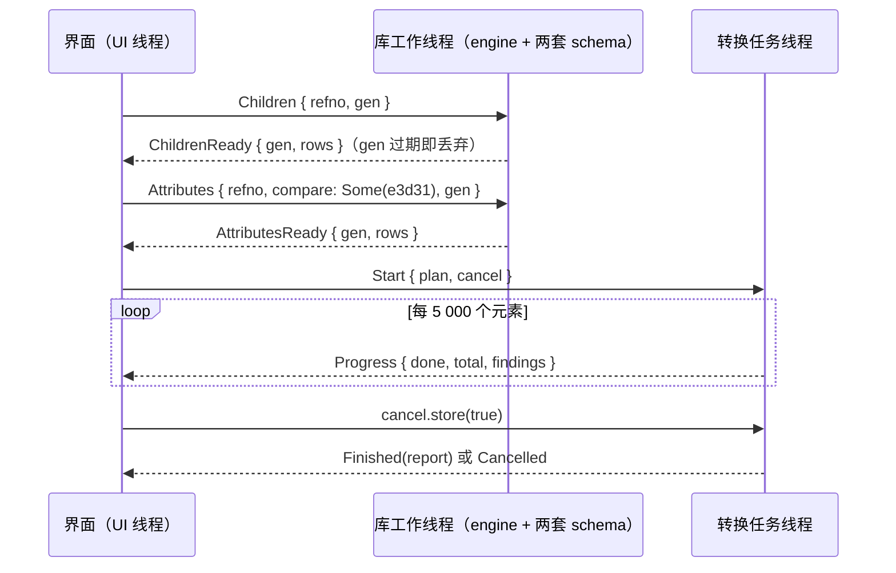
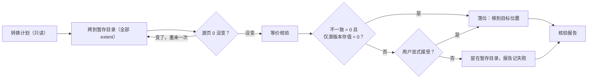

# e3d-studio：E3D 库浏览与版本转换 GUI 设计

2026-09-30 · 状态：设计，未实现。§2 的决策按用户「按推荐方案继续」全部取推荐默认；改选哪一项，就改那一行和它引出的条目。词汇见 `GLOSSARY.md`「发布版本与转换」，两条硬决策见 `docs/adr/0001-e3d21-to-31-verified-carry-over.md`、`docs/adr/0002-gui-and-converter-outside-e3d-io.md`。

## 0. 结论

1. **2.1 → 3.1 不需要改写字节。** E3D 3.1 就地使用 2.1 写的库（§1.1 F1、F2）。所以 M1 的转换是原样携带加等价核验：把库连同全部 extent 拷出，在 `e3d210`、`e3d31` 两个 schema 包下逐元素解码比对，核验通过才落到目标位置（ADR-0001）。
2. **核验有实际判别力。** 本机 E3D 2.1 下 536 个库、1 535 万个元素里，除 SLADDR 外，存下的值两版读出来全部相同。SLADDR 在 3.1 删了一个属性，后面 13 个属性前移，2.1 写的梯子在 3.1 schema 下读成了别的值。含 SLADDR 的库默认不落位、逐元素点名；E3D 3.1 实际怎么读它，靠一道 E3D 门坐实（§7 Q1）。
3. **GUI 做四件事**：秒开库（只读页 0、页 1 和会话页）；懒加载元素树；同一元素按两个发布版本对照解码的属性表；四步转换向导（选库 → 计划 → 执行 → 报告）。
4. **代码放在新 workspace `vendor/e3d-studio`**：`e3d-convert`（无 UI 的库加 CLI，GUI 与 CI 共用）和 `e3d-studio`（gpui-kit 应用）。e3d-io 只补几个通用只读接口（ADR-0002，§4.7）。
5. **速度够用**：核验单线程约 10.7 万元素/秒（每个元素解码两次）。普通 DESI 库亚秒级，最大的 CATA 库 `ams7351_0001`（1.2 GB、335 万元素）27 秒。

## 1. 设计依据

### 1.1 2.1 与 3.1 的库在字节上的关系（2026-09-30 实测）

测量用的是一个一次性探针（直接调 e3d-io 读侧 API，§4.4 的核验算法就是它，测完已删除）。T1（§6）落地后可用 `e3d-convert` 重跑出同样的数。

| # | 事实 | 数据 |
|---|---|---|
| F1 | AVEVA 的 3.1 样例沿用 2.1 的库文件 | AvevaMarineSample 两树成对 455 个库：425 个逐字节相同；9 个是「2.1 的字节 + 3.1 追加的页」（最新会话 DAB 标签 `2_35_23o`）；16 个只有页 0 不同（两边会话号、DAB 标签相同）；5 个在共同长度内还有别的页不同（`amssys`、`amscom`、`ams1112`、`ams7326`、`ams7997`，都是 3.1 使用中写入的）。AvevaCatalogue 44 个库全部逐字节相同 |
| F2 | 两版的模板版本相同 | `desvir` / `catvir` / `dicvir` 头字 3 两版都是 1。E3D 打开库时拿 `abs(TMPLVN)` 与它比（2.1 `db2_open_db` `0x1062F8F0`，3.1 `0x5AF9EF0`，见 `docs/evidence/2026-09-11-e3d-database-version.md`）。成对的库页大小都是 2 048 B |
| F3 | DESI 的 schema 差异 | 2.10 的 745 个 noun 在 3.1 全部还在，3.1 共 1 113 个。745 个里 60 个是表（`NAME`、`SPRE`、`TYPEX`、`SPAMAP` …），不是元素 noun。其余 685 个：327 个完全相同；329 个只新增属性；27 个只有扩容属性（共 32 个，如 `STEX` 480 → 1 024 字节、`HCREF` / `TCREF` 10 → 100 个）；`SLADDR` 有 13 个迁位属性（删 `FOOTRO` 后前移，chunk-1 默认值不再是前缀）；`CONVEY` 删了 `RLST`。13 934 个属性里 13 887 个位置不变，3.1 新增 928 个 |
| F4 | CATA / DICT 的 schema 差异 | CATA 165 → 191 个 noun，4 个扩容属性，无迁位；DICT 81 → 95 个 noun，33 个扩容属性，无迁位 |
| F5 | 全语料等价核验 | E3D2.1 下 6 个项目、536 个库（DESI 456 / CATA 63 / DICT 17，含 AvevaMarineSample 根目录下 7 份人工副本）、15 352 620 个元素（其中 compact 781 044 个）。两版都有的属性行 265 173 400：相同 265 167 053；默认值变化 6 295（`UDA.UCASES` 6 267、`CABLE.FILCHK` 28）；不一致 52；只在 2.10 有且存了值 22；3.1 新增属性读出存值 0；读错 0；缺模板的 noun 0。用时 143.9 s |
| F6 | 不一致全在 SLADDR | 22 个 SLADDR 元素分布在 8 个库：7 个是 `ams1112_0001*` 人工副本（每份 3 个，同一批元素），1 个在 AVEVA 原件 `acp7048_0001`，而这个文件在 3.1 Catalogue 树里逐字节相同。例：`=15240/1968` 的 `HRSTAR` 2.10 读 1200、3.1 读 0，`FRAD` 1200 → 50，`POSTEX` 1000 → 100。3.1 的每个属性读到的是 2.1 里排在它前一位的属性的值 |
| F7 | compact 记录两版读法相同 | 78.1 万条 compact 记录无一不一致（两版 compact 位置相同）。E3D 3.1 只在第一次修改某条记录时才把它展宽（`sub_5AECBE0`） |
| F8 | 核验不到的库类型 | E3D2.1 树里另有 354 个库是其它类型（PADD 126、MANU 102、ISOD 34、SCHE 25、PROP 19、ENGI 14、XPRD 10、COMM / MISC / SYST 各 6、NSEQ 5、ALYS 1）：schema 包清单只登记了 DESI / CATA / DICT 的模板 |

### 1.2 e3d-io 现成可用的与限制

- **打开**：`ReadOnlyEngine::open` 只读页 0、页 1 和最新会话页；`open_at(path, SessionSelector)` 回到任一保留会话；`header_diagnostics()` 给出 `CRINFO`、`TMPLVN`、`FORMAT`、会话号与 DAB 标签；`project_dabacon_tags(root)` 一次盘点整个项目。
- **浏览**：`world()`、`find_element`、`find_by_name`、`ParsedElement::parse_as`（成员表、owner、noun、explicit 流）；`DbSet` / `DbElement` 是线程安全的门面（`member_refnos`、`stored_name`、`display_name`、`attribute`）。
- **属性**：`extract_parsed_element_with_descriptors(&self, refno, &parsed, &attlib, &template)` 让同一份解析结果在两套 schema 下各解一次，属性对照和核验都靠它；`resolve_hunks` 先把 hunk 换成值。
- **会话**：`sessions()`、`diff_sessions`、`changed_elements`、`ElementDelta::of`。
- **schema**：`SchemaPack::open_version(bundled_schema_root(), "e3d210")`；`TemplateFile::read_children` 列出全部 noun；`TemplateProvider::template_for` 取描述符与默认值。
- **限制**：发布版本不自动识别（`detect_*` 按设计报错）；`schema::project_database_paths` 是 `pub(crate)`；读侧方法都要 `&mut self`，`ReadOnlyEngine` 是否 `Send` 没有编译期断言；`TemplateProvider` 靠 `&mut` 缓存，每个线程要一份。写路径只写 3.1、只写单 extent，`set_attribute` 拒 compact，只能追加会话不能建库——M1 不写库，这些只约束 M2 的 SLADDR 重写。

### 1.3 gpui-kit 现成可用的与缺口

读的是 `d:\work\plant-code\old\gpui-kit`（Longbridge 上游，HEAD `201b55a`，crate `gpui-kit` 0.7.0；GPUI 取 crates.io 的 `gpui-pre =0.3.7`；edition 2024；Apache-2.0）。

- **引导**：应用只依赖 `gpui-kit`：`gpui_kit::application()` → `gpui_kit::init(cx)` → `gpui_kit::open_window(...)`。最后一步包一层 `Root`，对话框、通知、菜单都挂在它上面。
- **可直接用**：`DockArea`（面板拖拽、布局 JSON 持久化）；`DataTable`（行列双向虚拟化、列宽 / 排序 / 固定列、单行选择、右键菜单、`visible_rows_changed`）；`List`（虚拟列表、可搜索）；`TabBar`；`h_resizable` / `v_resizable`；`Input`；`Select`；`WindowExt::open_dialog` / `push_notification`；`Progress`、`Spinner`、`StatusBar`、`TitleBar`、`AppMenuBar`、右键菜单；`actions!` 加 `KeyBinding`；`TextView::markdown`（后台解析，放报告）；`Editor`（长文本）；rust-i18n（组件自带 zh-CN）；21 套主题。
- **缺口**：没有懒加载树（`Tree` 渲染虚拟化，但要先建好整棵 `TreeItem`，展开时整棵重排）；表格和树都只能单选；没有 diff 视图；没有文件选择的封装（GPUI 的 `cx.prompt_for_paths` / `prompt_for_new_path` / `reveal_path` 在 0.3.7 的签名未核实）；没有外部文件拖入的示例；没有任务与取消的抽象（照 `examples/stream-markdown` 的做法：后台 spawn、smol channel、前台 `cx.spawn` 收消息更新 entity；阻塞循环不会因为 drop 了 `Task` 就停，要自己查 `AtomicBool`）；没有内置 CJK 字体（走 DirectWrite 回退）。
- **要抄进应用 workspace 的构建设置**：`.cargo/config.toml` 里 MSVC 的 `link-arg=/STACK:8000000`，以及 `[profile.dev.package]` 里 gpui-pre、taffy、rustybuzz 等的 `opt-level = 3`。这两样不随依赖继承。

## 2. 决策

| # | 问题 | 采用（推荐默认） | 备选 | 依据 |
|---|---|---|---|---|
| D1 | 2.1 → 3.1 的转换做什么 | 原样携带加等价核验 | 规范化（追加会话把 compact 展宽、按 3.1 布局重写）；新建库重灌（e3d-io 不能建库） | F1、F2、F5、F7；ADR-0001 |
| D2 | 核验出迁位属性（SLADDR）怎么办 | 判「不一致」，该库不落位，报告逐元素点名；用户可对单个库显式「接受并携带」，报告留痕 | 只提示、照常落位；M1 就实现按 3.1 布局重写 | F6；§7 Q1 |
| D3 | 默认值变化 | 采用目标版本的默认，报告里列为提示 | 把源版本的默认写进记录，钉住 2.1 的显示（要写路径） | F5；E3D 3.1 读同样的字节也这样显示 |
| D4 | 转换单位 | 一个库文件连同全部 extent；可在项目库列表里多选成批 | 整个项目（SYST 里的库定义、MDB、evars 一起） | 项目级留到 M3 |
| D5 | 源版本怎么定 | 用户显式选；DAB 标签、`DBBLBX`、路径只作提示；按项目根记住选择 | 启发式自动选 | 版本证据文档：库里没有可靠的发布版本字段 |
| D6 | 哪些库类型能转换 | DESI / CATA / DICT；其它类型列出但标「不在核验范围」，不能转换 | 其它类型不核验、照样携带 | F8 |
| D7 | 输出安全 | 从不原地改；源只读打开；先写到输出目录下的暂存目录，核验通过（或按 D2 显式接受）才移到目标位置；目标已有同名文件要确认覆盖；拷完重读源页 0，变了就重来一次 | 直接写目标位置 | 源库可能正被 E3D 追加会话 |
| D8 | 外部真值 | M1 以进程内等价核验为准，并以 AVEVA 3.1 样例里逐字节相同的文件作对照；E3D 3.1 门是 CLI / CI 步骤（复用 `tools/e3d` 与 gen-model `l3_suite` 的驱动），GUI 里不放启动 E3D 的按钮 | GUI 里一键跑门 | 门要真 E3D 安装、项目副本和分钟级耗时 |
| D9 | 代码放哪 | 新 workspace `vendor/e3d-studio`：`e3d-convert` 加 `e3d-studio`；e3d-io 只补通用只读接口，MISSION 不改 | 放进 e3d-io；引擎写在界面里 | ADR-0002 |
| D10 | 并发 | 每个打开的库一个工作线程，独占 engine 和两套 schema；界面经通道收发，按代号丢弃过期应答；转换任务另开线程，各开各的 engine；取消靠 `AtomicBool` 按元素检查 | 多线程共享 `DbSet` 加锁 | engine 读都要 `&mut self` |
| D11 | 大树 | 自建懒加载虚拟树：扁平的可见行加 `uniform_list`，展开时才读子记录 | gpui-kit `Tree` | §1.3：它要先建好整棵树 |
| D12 | 界面语言 | 中文为主、英文兜底（rust-i18n）；noun、属性名、refno 原样显示 | | 团队文档都是中文 |
| D13 | 报告格式 | JSON（`e3d-convert-report/v1`）加 Markdown 渲染，放在输出旁，并记入应用历史 | | CLI 与 GUI 同一份 |
| D14 | 首个里程碑的范围 | §6 M1 | | |

## 3. 界面与交互

### 3.1 主窗口

用 gpui-kit 的 `DockArea` 布局，面板可拖动、可关，布局存盘。

| 区域 | 内容 | 组件 |
|---|---|---|
| 标题栏、菜单 | `e3d-studio — ams8000_0001（E3D 2.1）`；文件 / 视图 / 工具 / 帮助 | `TitleBar`、`AppMenuBar` |
| 工具栏 | 打开库、打开项目；源版本下拉（必选）；对照版本下拉（可空）；会话下拉（最新 / 指定会话）；搜索框（名字或 `=w0/w1`）；「转换…」主按钮 | `Button`、`Select`、`Input` |
| 左侧 | 「库」页签：打开的库与项目库列表（类型、大小、会话数、最新 DAB 标签、extent 数、能否核验）；「树」页签：元素树 | `DataTable`、自建懒加载树 |
| 中央页签 | 属性（默认）、记录（M2）、会话差异（M2）、报告 | `DataTable`、`TextView` |
| 右侧 | 头信息：库类型、`FORMAT`（UTF-8 / 项目码页）、`TMPLNO` / `TMPLVN`、`CRINFO`、会话号与 DAB 标签、页数与页大小、extent；下方「引用我的」（M2） | `description_list` |
| 底部页签 | 会话列表、任务（进度 / 取消）、日志 | `List`、`Progress` |
| 状态栏 | 路径、文本编码、页缓存命中、后台任务进度、新会话提示 | `StatusBar` |

### 3.2 交互清单

| 场景 | 用户动作 | 界面反馈 | 快捷键 |
|---|---|---|---|
| 打开库 | 菜单或工具栏选文件；拖入窗口；最近列表 | 立刻显示头信息与根元素 WORL；项目第一次打开时弹出「源版本」选择（列出 DAB 标签等提示，不预选） | Ctrl+O |
| 打开项目 | 选项目文件夹 | 库列表逐行出现（后台逐库读头），可按类型、大小、DAB 标签排序和过滤 | Ctrl+Shift+O |
| 浏览树 | 展开、收起、键盘移动 | 展开时读子记录；每行显示 noun、名字（没存名字时显示位置名）、refno；超大成员表只取可见行的名字 | ← → ↑ ↓ Enter |
| 定位 | 点面包屑里的 owner 链；前进、后退 | 树和属性表一起跳 | Alt+← / Alt+→ |
| 搜索 | 输入 `/NAME` 或 `=24384/23257` | 命中就选中并展开到它；没命中说明原因（名字表里没有 / 索引里没有） | Ctrl+F、Ctrl+G |
| 看属性 | 选中元素 | 每行：名字、值、状态（存值 / 模板默认 / 非 implicit …）、存储（implicit 字偏移 / explicit / hunk）；过滤框；双击看长值（文本、数组、hunk） | |
| 对照 | 工具栏选对照版本 | 多一列目标版本的值和差异标记：相同 / 默认值变化 / 不一致 / 仅源版本 / 目标新增；「只看差异」开关 | Ctrl+D |
| 复制 | 右键行或单元格 | 复制值、属性名、refno 或整行（制表符分隔） | Ctrl+C |
| 看会话 | 底部会话列表（号、时间、用户、注释、DAB 标签） | 选中后可「按此会话查看」：整个视图切到那个会话（`open_at`），标题栏标出会话号 | |
| 刷新 | 状态栏提示「库有新会话 646 → 648」 | 点一下切到最新会话，树和属性保持当前选中 | F5 |
| schema 差异 | 工具 → schema 差异，选两个 schema 包和库类型 | noun 按类别分组（相同 / 只增 / 扩容 / 迁位 / 删属性），选中看属性级差异 | |
| 转换 | 工具栏「转换…」，或在库列表勾选后右键 | 打开转换向导（§3.3） | Ctrl+Shift+E |
| 任务 | 底部任务页签 | 每个任务一行：阶段、进度、剩余时间、取消；完成时弹通知，点开报告 | |
| 设置 | 文件 → 设置 | schema 根目录（默认用内置 `schema/`）、各版本 binaries 位置（显示环境变量是否生效）、页缓存大小、主题、语言 | Ctrl+, |

### 3.3 转换向导

1. **选库**：当前库，或项目库列表里勾选的多个库（勾选列用自绘单元格，因为 `DataTable` 只能单选）。源版本沿用浏览时的选择；目标版本在 M1 只有 E3D 3.1 可选，其它显示「尚无转换路线」。选输出目录。
2. **计划**（只读，秒级）：每个库一行检查结果（✓ / ✗ / !）：
   - 库族：会话的主表与索引树身份对属于已知版本；
   - 模板版本：库的 `abs(TMPLVN)` 等于目标 `*vir.dat` 的头字 3；
   - 库类型在目标 schema 包里有模板（D6）；
   - extent 齐全（`_0002` …）；
   - 本类型的迁位 noun 列表（M1 即 DESI 的 SLADDR），提示「库里若有这些 noun，核验会判不一致」；
   - 最新会话的 DAB 标签是 3.1 引擎写的（`2_35_*`）时提示「源版本选 E3D 2.1 可能不对」；
   - 输出位置可写、不同于源，同名文件是否已存在。

   有 ✗ 的库不能勾选。底部汇总：库数、元素数（索引键数，取数很快）、预计用时（按 10 万元素/秒估）。
3. **执行**：每个库依次拷贝 → 核验 → 落位。进度按「已核验元素 / 索引键数」算。可以取消，取消后清掉暂存目录，目标位置不动；一个库失败不影响其它库。
4. **报告**：汇总卡片（通过 / 需确认 / 失败 / 已取消）；每个库的分类计数；「不一致」和「仅源版本且存了值」逐元素列出（refno、名字、noun、属性、源值、目标值），双击回到浏览视图并打开该元素的对照。「需确认」的库提供「接受并携带」，二次确认后落位，报告记下接受人和时间。可导出 JSON / Markdown，可在资源管理器里显示输出。

### 3.4 反馈与错误

- 打不开、库族不对、模板版本不符：面板内横幅，原样给出 e3d-io 的错误文本，不吞不改。
- 没选源版本时，属性区显示「请选择源版本」，不猜。
- 超过 200 ms 的操作都在后台跑，显示进度，能取消。
- 后台任务结束时弹通知，点通知打开报告。

## 4. 功能实现

### 4.1 代码落点

```text
vendor/e3d-studio/
├── Cargo.toml              # [workspace]；依赖按路径指向 e3d-io / e3d-attlib / gpui-kit；profile 覆盖抄自 gpui-kit
├── .cargo/config.toml      # [target.x86_64-pc-windows-msvc] rustflags = ["-C", "link-arg=/STACK:8000000"]
├── crates/e3d-convert/     # 无 UI：库 + bin `e3d-convert`（plan / run / verify / schema-diff）
│   └── src/
│       ├── release.rs      # 发布版本与转换路线表；M1 只有 e3d210 → e3d31（原样携带）
│       ├── schema_diff.rs  # 两个 schema 包逐 noun、逐属性分类
│       ├── inventory.rs    # 项目库列表：类型、大小、会话、DAB 标签、extent
│       ├── plan.rs         # 转换计划的各项检查
│       ├── materialize.rs  # 拷到暂存、源页 0 前后比对、落位
│       ├── verify.rs       # 等价核验：逐元素两次解码、按 hash 连接、归类
│       ├── report.rs       # 核验报告（serde）与 Markdown 渲染
│       └── progress.rs     # 进度事件与取消标志，与 UI 无关
└── crates/e3d-studio/      # gpui-kit 应用
    ├── src/
    │   ├── main.rs · app.rs · workspace.rs · settings.rs
    │   ├── db/worker.rs · db/protocol.rs      # 库工作线程与请求 / 应答
    │   ├── panels/{library,tree,attributes,header,sessions,jobs,log,schema_diff,report}.rs
    │   └── convert/{wizard,job}.rs
    └── locales/{zh-CN,en}.yml
```

```toml
# vendor/e3d-studio/Cargo.toml（节选）
[workspace]
members = ["crates/e3d-convert", "crates/e3d-studio"]
resolver = "3"

[workspace.dependencies]
e3d-io = { path = "../e3d-io-write" }            # 当前 write-path 工作树；合回 main 后改指 ../e3d-io
e3d-attlib = { path = "../e3d-attlib" }           # 必须与 e3d-io 用的是同一个 e3d-attlib
gpui-kit = { path = "../../gpui-kit/crates/kit" } # 只依赖它，不直接依赖 gpui
```

### 4.2 交互到实现的对应

| 交互 | e3d-io 调用 | 新代码 | 跑在哪 |
|---|---|---|---|
| 打开库、头信息 | `ReadOnlyEngine::open`、`header_diagnostics`、`descriptor`、`file_info`、`readable_page_count` | 库线程的 `Open` 请求 | 库线程 |
| 项目库列表 | `project_dabacon_tags`、`database_header_diagnostics`；枚举库路径要 `project_database_paths` 公开（§4.7） | `e3d_convert::inventory` | 任务线程 |
| 根元素、展开 | `world`、`find_element` + `ParsedElement::parse_as` 取成员；子记录批量读 noun 与存下的 `NAME` | `Children { refno, gen }`；树面板的扁平可见行 | 库线程 |
| 搜索 | `find_by_name`、`find_element` | 名字与 refno 的输入解析 | 库线程 |
| 属性（单版本） | `find_element` → `parse_as` → `resolve_hunks` → `extract_parsed_element_with_descriptors` | 值的文本渲染（§4.7） | 库线程 |
| 属性对照 | 同一个 `parsed` 在两套 `(AttlibData, NounTemplate)` 下各解一次 | `e3d_convert::verify::compare_rows`，与核验共用 | 库线程 |
| 会话列表、按会话查看 | `sessions`、`open_at` | `Reopen { at }` 请求 | 库线程 |
| 新会话提示 | 每 5 秒重读页 0，比较最新会话页号 | `Poll` 请求 | 库线程 |
| schema 差异 | `TemplateFile::read_children`、两个 `TemplateProvider::template_for` | `e3d_convert::schema_diff` | 任务线程 |
| 转换计划 | 上面各项，加 `indexed_refnos().len()` | `e3d_convert::plan` | 任务线程 |
| 执行 | `std::fs` 拷贝；拷前拷后读源页 0 比对 | `e3d_convert::materialize` | 任务线程 |
| 核验 | `indexed_refnos` → 逐元素 `find_element` / `parse_as` / `resolve_hunks` / 两次解码 | `e3d_convert::verify` | 任务线程，每库一个，可并行 |
| 报告 | — | `e3d_convert::report`；用 `TextView::markdown` 显示 | UI |
| 会话差异（M2） | `diff_sessions`、`changed_elements`、`ElementDelta::of` | 差异面板 | 任务线程 |
| 引用我的（M2） | `referrers_of` | 引用面板 | 库线程 |

### 4.3 线程与数据流



- 库线程是一个 `std::thread`，阻塞在请求通道上，独占 `ReadOnlyEngine`，每个用到的发布版本持一份 `TemplateProvider`；`AttlibData` 用 `Arc` 共享。应答走 smol channel，前台一个 `cx.spawn` 循环收应答、更新 entity、`cx.notify()`。
- 每个请求带代号 `gen`。用户连点时只认最新的，旧应答直接丢。
- 转换任务不借用浏览中的 engine，自己打开（开库只读 3 页，代价可忽略），所以核验跑着也能照常浏览。进度事件最多 10 次/秒。

### 4.4 转换流水线



核验对每个元素做：`find_element` → `parse_as` → `resolve_hunks` → 取源、目标两版的 `NounTemplate` → 各解一次 → 按属性 hash 连接，逐行归类：

| 类别 | 条件 | 判定 |
|---|---|---|
| 相同 | 状态类别与值都相等 | — |
| 默认值变化 | 两边都没存值，给出的默认不同 | 提示 |
| 不一致 | 至少一边存了值，且值不同 | 阻断 |
| 仅源版本（存了值） | 目标 schema 没有这个属性，源存了值 | 阻断 |
| 仅源版本（未存值） | 同上，但没存值 | 只计数 |
| 目标新增 | 源 schema 没有这个属性 | 只计数；若读出「存了值」则阻断（语料里 0 例） |
| 缺模板 | 任一版本没有这个 noun | 阻断 |
| 读错 | 记录、解析或 hunk 读不出 | 阻断 |

compact 记录只计数，不阻断（F7）。

### 4.5 核验报告格式

```json
{
  "schema": "e3d-convert-report/v1",
  "route": { "source": "e3d210", "target": "e3d31", "method": "carry-over" },
  "tool": { "e3d_convert": "0.1.0", "e3d_io": "0.4.0" },
  "database": {
    "source": "D:\\AVEVA\\Projects\\E3D2.1\\AvevaCatalogue\\acp000\\acp7048_0001",
    "output": "…\\acp7048_0001",
    "extents": 1, "db_type": "DESI", "session": "…", "dab_tag": "…", "sha256": "…"
  },
  "checks": [
    { "id": "template-version", "status": "pass", "detail": "TMPLVN -1; target header word 3 = 1" }
  ],
  "counts": {
    "elements": 10034, "compact": 0, "rows": 217797, "equal": 217787,
    "default_changed": 0, "mismatch": 10, "source_only_stored": 1
  },
  "findings": [
    { "kind": "mismatch", "refno": "15240/1968", "noun": "SLADDR",
      "attribute": "HRSTAR", "source": "1200", "target": "0" }
  ],
  "verdict": "needs-acceptance",
  "accepted": null
}
```

- `verdict` 取 `passed` / `needs-acceptance` / `failed` / `cancelled`。
- `findings` 最多存 10 000 条，另按 `(noun, 属性, 类别)` 汇总计数，大库的报告也不会太大。
- 报告写在输出文件旁（`<库名>.e3d-convert.json` 与 `.md`；带扩展名的文件不会被当成库），并记入应用数据目录的历史。

### 4.6 性能预算

| 操作 | 预算 | 依据 |
|---|---|---|
| 打开库到首帧显示头信息 | < 100 ms | 只读 3 页 |
| 展开 8 200 个成员的 ZONE | < 150 ms | F5 的吞吐（每元素两次解码）已超过 10 万元素/秒，只解析会更快 |
| 选中元素到出属性表（含对照） | < 10 ms | 单元素两次解码 |
| 项目库列表（约 450 个库） | < 2 s | 每库只读头；两树 455 对连同字节比对共用 3.7 s |
| 核验 | 约 10 万元素/秒/线程，多库并行 | F5；`ams7351_0001` 27 s |
| 拷贝 | 受磁盘带宽限制，按字节报进度 | 1.2 GB 级文件 |
| 内存 | 每个打开的库默认 256 页缓存（512 KB）；核验只留计数和截断的发现列表 | `open_with_cache` |

### 4.7 e3d-io 需要补的只读接口

1. `schema::project_database_paths` 改为 `pub`（或另加一个公开的项目库枚举）：项目库列表要用，现在只在 crate 内可见。
2. `ReadOnlyEngine: Send` 的编译期断言（加一个测试）：库线程要把 engine 移进线程。
3. 值的文本渲染：确认 `tty` 模块和 `e3d-descriptor` 现有的 TTY 口径渲染是否公开；不公开就公开一个，属性表、报告、CLI 共用一种写法。
4. （M2）schema 包清单登记 SYST / COMM / MISC / PADD … 的 `*vir.dat`（binaries 里已经有这些文件），把可核验的库类型扩到 F8 那 354 个库。

这几条都是读侧、与发布版本无关的通用接口，在 MISSION 的范围内。

## 5. M1 验收

1. 打开 E3D2.1 的 `ams7351_0001`（1.2 GB）：1 s 内出头信息；展开任意节点时 UI 线程单帧 < 16 ms（读都在库线程）。
2. `e3d-convert` CLI 与 GUI 对同一输入产出的报告，除时间字段外逐字段相同。
3. 对 E3D2.1 下全部 DESI / CATA / DICT 库跑转换：计数与 F5 一致；含 SLADDR 的 8 个库判「需确认」，其余「通过」。
4. AVEVA 3.1 样例里与 2.1 逐字节相同的 317 个 DESI / CATA / DICT 库（Marine 282、Catalogue 35）：转换输出的 SHA-256 与 3.1 树里的文件相同（`acp7048_0001` 先按 D2 接受）。
5. 源文件转换前后 SHA-256 不变。
6. 核验中途取消：1 s 内停下，暂存目录清空，目标位置没有残留。
7. E3D 3.1 门（CLI，复用 `tools/e3d` 的驱动）：把若干转换输出放进项目副本，TTY 会话读回抽样元素的属性，与 e3d-io 按 `e3d31` 解出的值一致；并回答 §7 Q1。

## 6. 里程碑

**M1：浏览 + 2.1 → 3.1 原样携带**

| 任务 | 内容 | 依赖 |
|---|---|---|
| T1 | `e3d-convert`：`schema_diff`、`inventory`、`plan`、`materialize`、`verify`、`report` 与 CLI；把 §1.1 的测量写成以语料为输入的测试 | T2 |
| T2 | e3d-io 小改：§4.7 第 1–3 条 | — |
| T3 | 应用骨架：workspace 与构建设置、窗口、Dock 布局与存盘、设置、i18n、主题、中文字体回退 | — |
| T4 | 库工作线程；头信息；懒加载树；搜索；前进后退 | T3 |
| T5 | 属性表：单版本与对照 | T1、T4 |
| T6 | 会话列表、按会话查看、新会话提示 | T4 |
| T7 | 转换向导、任务面板、报告视图 | T1、T3 |
| T8 | §5 验收；E3D 门问 Q1 | 全部 |

**M2**：会话差异；记录检查器（原始字加描述符叠加，贴合本仓库的逆向工作方式）；引用我的；schema 差异视图；扩大可核验的库类型（§4.7 第 4 条）；按 Q1 的结果补 SLADDR 的读侧规则，或加一步按 3.1 布局重写（重写的是几何元素，依赖写路径第三期的 SPAMAP 维护）。

**M3**：其它转换路线，如 3.1 → 2.1（3.1 新增的 noun、扩容后超出 2.1 容量的值要降级或拒绝，还要一道 E3D 2.1 门；本机有 `D:\AVEVA\Everything3D2.10\des.exe`，能否跑 TTY 未验）；项目级转换。

## 7. 待坐实

| # | 问题 | 怎么查 | 影响 |
|---|---|---|---|
| Q1 | E3D 3.1 怎么读 2.1 写的 SLADDR | 在 AvevaCatalogue 副本里开 TTY 会话，对 `=15240/1968` 查 `Q HRSTAR`、`Q FRAD`、`Q POSTEX`。打印 1200 / 1200 / 1000：core 有补偿规则，e3d-io 读侧要学（再去 IDA 取证）。打印 0 / 50 / 100：E3D 3.1 自己也读偏，原样携带保留的是 AVEVA 的行为，重写就成了「修复」而不是转换 | D2、M2 |
| Q2 | `ReadOnlyEngine`、`AttlibData` 是否 `Send` / `Sync` | 编译期断言 | D10 |
| Q3 | gpui-pre 0.3.7 里 `prompt_for_paths` / `prompt_for_new_path` / `reveal_path` 的签名；外部文件拖入（`ExternalPaths` + `on_drop`） | T3 里写最小例子 | §3.2 打开库 |
| Q4 | e3d-io 里是否已有公开的值文本渲染 | 读 `src/tty.rs` 与 `src/bin/e3d-descriptor.rs` | §4.7 第 3 条 |
| Q5 | 能否用 `TYPEX` 表（`referrers_of` 查 `[1, noun]`）秒级数出某个 noun 的元素数 | 对 `acp7048_0001` 数 SLADDR | 计划阶段就能预告 SLADDR |
| Q6 | 中文在 Windows 上的字形回退是否够用 | T3 截图检查；不够就把 `font_family` 设成 Microsoft YaHei UI | D12 |
| Q7 | E3D 2.1 能否读 wide 记录 | 只影响 3.1 → 2.1 路线 | M3 |
